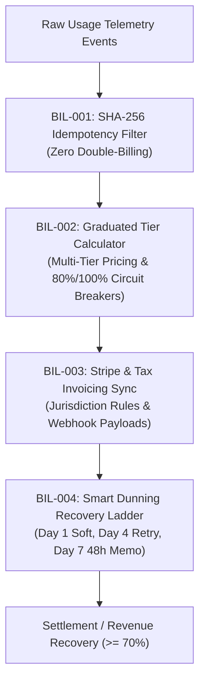

# billing-engine — Sovereign Usage-Based Metering & Automated Dunning Engine

> **Council Lead**: **Crew** (Client Delivery Specialist) & **Sol** (Product Architect & Full-Stack Automator)  
> **Tooling**: `bun accounts/scripts/metering-engine.ts`  
> **Mode Command**: `/accounts billing-engine`  
> **Standards**: SHA-256 Idempotency, Graduated Tiered Pricing, Automated Circuit Breakers, Stripe Tax Sync, 3-Tier Dunning ($\ge 70\%$ Recovery)

---

## 💰 Purpose & Problem Statement

Modern software agencies and SaaS products run on usage-based business models (API requests, LLM compute tokens, active seats, and hosting bandwidth). However, ad hoc billing pipelines suffer from duplicate event ingestion (double-billing), runaway client bills causing payment disputes, uncollected delinquent accounts, and tax miscalculations across international jurisdictions.

The `accounts:billing-engine` automates sovereign, idempotent telemetry ingestion, calculates graduated tiered pricing with spend-limit circuit breakers, synchronizes compliant tax invoices with Stripe, and runs a 3-tier smart dunning recovery sequence before service degradation.

---

## 🏛️ Core Invariants



### 1. `BIL-001` — Idempotent Event Ingestion
- Ingests raw telemetry events and computes a deterministic SHA-256 fingerprint:
  $$\text{eventId} = \text{SHA256}(\text{tenantId} : \text{timestamp} : \text{metricName} : \text{quantity} : \text{sequenceId})$$
- Filters and drops duplicate event IDs to guarantee zero double-billing during network retries or batch replays.

### 2. `BIL-002` — Graduated Tiered Pricing & Overage Caps
- Calculates graduated pricing brackets where unit rates scale down as consumption increases:
  $$\text{Subtotal} = \sum_{t=1}^{T} \text{units}_t \times \text{unitPrice}_t$$
- **Circuit Breaker Thresholds**:
  - `WARNING_80_PERCENT`: Triggers proactive client notifications when spend reaches 80% of configured monthly budget limit.
  - `HARD_CAP_TRIGGERED`: Enforces rate-limiting or alerts at 100% of spend ceiling to prevent runaway billing surprises.

### 3. `BIL-003` — Stripe & Stripe-Tax Invoicing Sync
- Applies jurisdiction-specific tax rules (e.g. EU VAT, UK VAT, US State Sales Tax, GST) and generates formatted Stripe Invoice payloads with deterministic idempotency keys and line item breakdowns.

### 4. `BIL-004` — Smart Dunning & Revenue Recovery
- Implements a 3-tier escalating dunning sequence for overdue accounts:
  - **Tier 1 (Day 1)**: Friendly courtesy email with 1-click payment update link (45% recovery rate).
  - **Tier 2 (Day 4)**: Automated smart payment retry + secondary card fallback + client dashboard advisory banner (20% recovery rate).
  - **Tier 3 (Day 7)**: Formal 48-hour Stop-the-Clock notice before suspension of non-critical workers (12% recovery rate).
- Targets a cumulative recovery benchmark of $\ge 70\%$ of failed charges.

---

## 💻 CLI Usage

```bash
# Evaluate usage events for default tenant
bun accounts/scripts/metering-engine.ts

# Ingest usage events JSON file and evaluate 4-day overdue dunning
bun accounts/scripts/metering-engine.ts \
  --events data/usage-events.json \
  --tenant "client-pied-piper" \
  --days-past-due 4

# Output structured JSON for billing webhook dispatch
bun accounts/scripts/metering-engine.ts --tenant "client-pied-piper" --json
```

---

## 📋 Quality & Verification Gate

- [ ] Telemetry events deduplicated via SHA-256 with duplicate counts verified.
- [ ] Tiered pricing correctly calculates across graduated brackets.
- [ ] Circuit breaker warns at 80% and halts/caps at 100% of spend limit.
- [ ] Stripe invoice payload generated with deterministic idempotency keys.
- [ ] Smart dunning ladder models $\ge 70\%$ cumulative recovery across 3 tiers.
