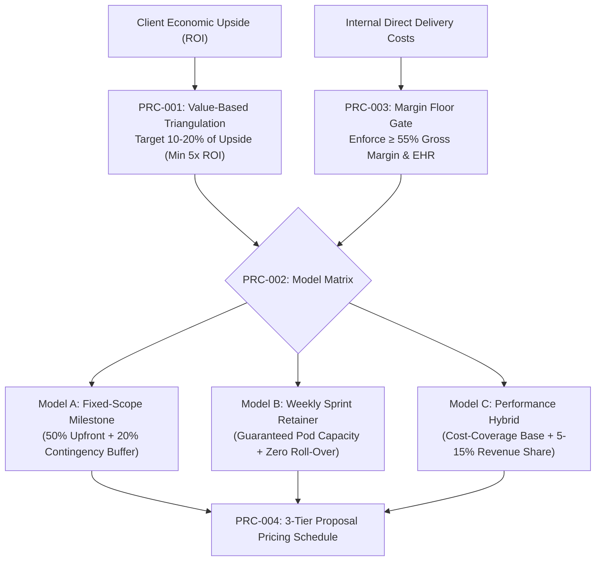

# pricing — Value-Based Pricing Architecture & Profitability Calculator

> **Operating Role**: Crew & Sol (Agency Council Operations & Finance Delivery)  
> **Direct Triggers**: "pricing model", "agency pricing", "value-based pricing", "profitability calculator", "sprint retainer vs fixed scope", "pricing schedule", "quote calculator"  
> **Core Directives**: PRC-001 through PRC-004  

The `pricing` mode provides value-based pricing triangulation, contract delivery model comparison (Fixed-Scope Milestones vs Dedicated Weekly Sprints vs Performance Hybrid), margin floor enforcement, and automated pricing schedule generation for agency quotes and master service agreements.

---

## The 4 Core Invariants (PRC-001 – PRC-004)



### PRC-001: Value-Based Pricing Triangulation
- **Economic Value Grounding**: Never quote client projects purely on raw hourly estimates. Triangulate agency fees against estimated business impact:
  1. **Quantified Upside**: Assess client revenue gains, cost savings, or customer conversion lift over a 12-month window.
  2. **ROI Multiple Requirement**: The project investment must deliver an expected client return $\ge 5.0\times$.
  3. **Value Anchor**: The agency quote should capture between $10\%$ and $20\%$ of the client's projected annual economic value created.
  4. **Cost-Plus Floor**: Direct labor costs (internal salary / contractor hours) + dedicated tooling and infrastructure costs divided by $(1 - \text{target gross margin})$.

### PRC-002: Delivery Model Architecture Matrix
Evaluate client engagement fit across 3 distinct contract archetypes:

| Contract Model | Ideal Scenario | Payment Structure | Risk Allocation & Fencing |
|:---|:---|:---|:---|
| **Fixed-Scope Milestone** | Well-defined specifications, static requirements, single launch targets. | 50% upfront deposit upon contract signing, 25% at mid-point milestone demo, 25% upon final UAT sign-off. | Built-in 20% risk contingency buffer; strict Change Order gating for any out-of-scope requests; 48h Stop-the-Clock clause. |
| **Weekly Sprint Retainer** | Evolving roadmap, agile product iteration, high velocity requirements. | Billed bi-weekly or monthly in advance ($X/sprint). Guaranteed pod capacity (e.g. 1 senior full-stack + 0.5 designer). | Scope is flexible; capacity is fixed. Unused sprint days expire with zero roll-over; client directs priority backlog. |
| **Performance / Rev-Share Hybrid** | High-growth e-commerce or SaaS funnel with verified conversion baselines. | Reduced base retainer covering direct labor costs + 5%–15% net revenue lift or verified qualified lead bounty. | Requires signed telemetry and attribution escrow; minimum 3-month commitment; quarterly audit reconciliation. |

### PRC-003: Guaranteed Margin Floor ($\ge 55\%$)
- **Gross Margin Invariant**:
  $$\text{Gross Margin} = \frac{\text{Contract Price} - \text{Direct Delivery Costs}}{\text{Contract Price}} \ge 55\%$$
- **Effective Hourly Rate (EHR) Monitoring**:
  $$\text{EHR} = \frac{\text{Total Net Revenue Received}}{\text{Total Production Hours Dedicated}}$$
- **Rejection Gate**: Any proposal or quote yielding an estimated gross margin $< 50\%$ or an EHR below the agency threshold ($\$125/\text{hr}$ baseline) must be automatically blocked from client presentation.

### PRC-004: Proposal Pricing Schedule Generator
Every client deliverable proposal must provide a standardized three-option pricing schedule:
- **Tier 1 (Core / Foundation)**: Solves the immediate critical problem with lean architecture.
- **Tier 2 (Growth / Velocity — Recommended)**: Full-stack implementation including analytics, automated test coverage, and 30-day post-launch warranty.
- **Tier 3 (Turnkey / Scale)**: Dedicated pod, multi-region edge deployment, ongoing sprint iterations, and real-time monitoring.

---

## Pricing Schedule Markdown Schema

```markdown
### Deliverable Pricing & Investment Options

| Investment Tier | Commitment | Included Scope | Payment Terms |
|:---|:---|:---|:---|
| **Tier 1: Foundation** | $12,500 | Core architecture, responsive layout, auth & database integration | 50% deposit / 50% completion |
| **Tier 2: Velocity (Recommended)** | $24,000 | Foundation + PWA offline support, analytics, E2E test suite, 30-day warranty | 40% deposit / 30% alpha / 30% completion |
| **Tier 3: Dedicated Pod Retainer** | $9,500 / sprint | Dedicated 2-week agile sprint pod (Full-stack + UX + QA), weekly releases | Billed in advance per sprint block |

*All options enforce 48h Stop-the-Clock terms, Net 14 payment terms, and statutory GST/VAT invoicing.*
```

---

## Verification & Acceptance Checklist

- [ ] Value triangulation validates client economic ROI $\ge 5\times$.
- [ ] Contract delivery model matches client product clarity and roadmap flexibility.
- [ ] Direct delivery costs and contractor allocations yield $\ge 55\%$ gross margin.
- [ ] Minimum Effective Hourly Rate floor is certified.
- [ ] Proposal pricing schedule includes three clear investment options with explicit payment terms.
