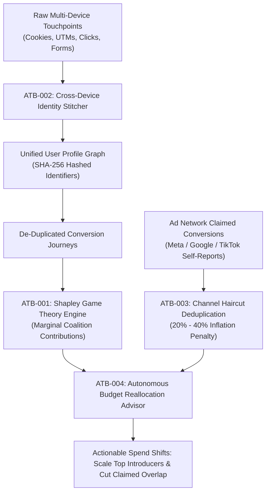

# attribution-graph — Multi-Touch Shapley Value Marketing Attribution & Identity Graph

> **Operating Role**: Nexus (Technical Director) & Jasper (Growth Mastermind)  
> **Direct Triggers**: "attribution graph", "shapley value", "multi-touch attribution", "identity stitching", "cross-device attribution", "haircut deduplication", "budget reallocation advisor"  
> **Core Directives**: ATB-001 through ATB-004  
> **Primary Tooling**: `skills/agency-delivery/analytics/scripts/attribution-graph.ts`

The `attribution-graph` mode eliminates single-touch bias (first-click / last-click) and self-reported ad network over-crediting. By combining cooperative game theory (Shapley Value formulation), cross-device identity stitching, haircut penalties, and algorithmic budget reallocation, it delivers the single source of truth for paid and organic marketing efficiency across the agency client portfolio.

---

## The 4 Core Invariants (ATB-001 – ATB-004)



---

### ATB-001: Cooperative Game Theory Shapley Value Calculation
- **Mathematical Principle**: Models each marketing channel as a player in a cooperative game. The Shapley value computes the average marginal contribution of channel $i$ across all possible channel subsets $S \subseteq N \setminus \{i\}$:
  $$\phi_i(v) = \sum_{S \subseteq N \setminus \{i\}} \frac{|S|!(|N| - |S| - 1)!}{|N|!} \Big(v(S \cup \{i\}) - v(S)\Big)$$
- **Elimination of Last-Touch Bias**: Channels that introduce users (First-Touch) and nurture mid-funnel consideration are credited fairly rather than awarding 100% credit to branded search or retargeting.
- **True ROAS Realization**: Computes incremental return on ad spend ($\text{ROAS}_{\text{Shapley}} = \frac{\text{Attributed Revenue}_i}{\text{Spend}_i}$) to reveal channels with artificial inflation.

### ATB-002: Cross-Device Identity Stitching
- **Graph Clustering**: Unifies disparate anonymous cookies across mobile, desktop, and tablet sessions into cohesive user journey clusters.
- **Zero-PII Hashing**: Ingested emails, phone numbers, and external customer IDs are immediately hashed with SHA-256 (`createHash('sha256').update(email).digest('hex')`) prior to graph traversal. Raw PII is never stored or logged.
- **Link Decoration**: Tracks anonymous IDs through registration, login, and purchase events to construct end-to-end multi-device funnels.

### ATB-003: Channel Haircut Deduplication Gate
- **The Self-Reporting Trap**: Ad networks (Meta, Google Ads, TikTok Ads) employ aggressive attribution windows (e.g. 7-day click / 1-day view) claiming credit for conversions they merely observed rather than caused.
- **Haircut Discount Schedule**:
  - `meta_ads`: 35% discount penalty on claimed conversions (penalizing view-through inflation).
  - `google_ads`: 25% discount penalty (penalizing branded search cannibalization).
  - `tiktok_ads`: 40% discount penalty (penalizing short-attention impression bleed).
  - `affiliates`: 30% discount penalty (penalizing last-second coupon hijacking).
  - `organic_seo` / `direct`: 0% discount (baseline first-party truth).
- **Single Count-of-Record**: De-duplicates multiple networks claiming the exact same transaction ID against the backend database of record.

### ATB-004: Autonomous Budget Reallocation Advisor
- **Data-Backed Capital Allocation**: Compares channel marginal Shapley ROAS against target agency margin floors (default $\ge 2.5\text{x}$).
- **Recommendation Vectors**:
  - **Scale (+25%)**: Channels with Shapley ROAS $\ge 1.5\times$ target floor and strong top-of-funnel introduction shares.
  - **Trim (-30%)**: Channels with Shapley ROAS $< 0.8\times$ target floor whose perceived volume was an artifact of double-counted self-reports.
  - **Maintain**: Channels operating within target pacing boundaries.
- **Projected Impact**: Calculates estimated incremental revenue unlocked by reallocating capital from under-performing closer channels to high-efficiency introducers.

---

## Execution Workflow

1. **Ingest Conversion Touchpoints**: Collect raw multi-touch logs including anonymous cookie IDs, timestamps, UTM tags, and user hashes.
2. **Execute Identity Stitching (`attribution-graph.ts`)**: Run graph clustering to bind multi-device touchpoints into singular customer journeys.
3. **Run Shapley Model**: Calculate marginal coalition shares for each marketing channel.
4. **Apply Haircut Penalties**: Discount platform-reported conversion numbers against backend transactional truth.
5. **Generate Budget Shift Plan**:
   ```bash
   bun skills/agency-delivery/analytics/scripts/attribution-graph.ts
   ```
6. **Delivery**: Export markdown report to `.agents/artifacts/attribution/attribution-report.md` for client marketing leads and C-suite executives.
