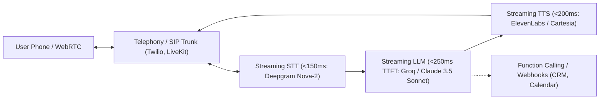

# voice — Real-Time Conversational Voice AI Agents & Telephony

> **Operating Principle**: Human telephone conversations require sub-600ms round-trip latency (from user speech end to agent audio output). Anything above 800ms feels mechanical and awkward. A production voice agent couples low-latency streaming Speech-to-Text (STT), fast LLM inference (with token streaming), ultra-realistic Text-to-Speech (TTS), and native telephony (Twilio / SIP trunking) with human handoff escalation paths.

---

## The Voice AI Stack Architecture



---

## Platform Selector & Deployment Matrix

| Provider / Tool | Best For | Typical Latency | Key Feature |
| :--- | :--- | :--- | :--- |
| **Retell AI** | Turnkey production voice agents, instant Twilio import | 500 – 700ms | Built-in backchanneling, interruptions, ambient noise cancellation |
| **Bland AI** | High-scale outbound sales/qualification calling | 600 – 850ms | Custom enterprise telephony routing, automated voicemail detection |
| **LiveKit Agents** | Sovereign open-source Python/Node.js voice pipelines | 400 – 600ms | Complete pipeline ownership, multi-modal WebRTC, zero vendor lock-in |
| **Twilio Voice + Media Streams** | Custom SIP gateway & carrier compliance | Carrier standard | Native carrier number porting, A2P/STIR-SHAKEN verification |

---

## Inbound Receptionist & Call Routing Blueprint

### Prompt Engineering for Voice vs Text
- **Sentence Length**: Maximum 15–20 words per clause. Keep speech concise.
- **Phonetic Pronunciations**: Spell out uncommon words phonetically (e.g. *"Acme: ACK-mee"*).
- **Filler & Backchanneling**: Inject subtle affirmations (*"Got it"*, *"Understood"*, *"Sure thing"*) to acknowledge caller input during function execution.

### Function Calling & Real-Time Tool Execution
```json
{
  "name": "book_calendar_slot",
  "description": "Book a 15-minute consultation on the sales calendar",
  "parameters": {
    "type": "object",
    "properties": {
      "caller_name": { "type": "string" },
      "preferred_time": { "type": "string", "description": "ISO 8601 datetime" },
      "phone_number": { "type": "string" },
      "project_type": { "type": "string", "enum": ["ecom", "saas", "design", "general"] }
    },
    "required": ["caller_name", "preferred_time", "phone_number"]
  }
}
```

---

## Human Warm Transfer & Escalation Guardrails

Voice agents must recognize when to bow out gracefully:
1. **Frustration / Sentiment Triggers**: Immediate escalation if caller repeats *"representative"*, *"human"*, or sentiment score drops below threshold.
2. **Cold Call Transfers**: Using Twilio `<Dial>` or Retell transfer action:
   ```json
   {
     "action": "transfer_call",
     "target_number": "+18005550199",
     "transfer_summary": "Caller Jordan Taylor asking about enterprise SLA terms."
   }
   ```
3. **Voicemail Drop & SMS Follow-up**: If call is unanswered or hits voicemail, automatically drop a tailored message and trigger a confirmation SMS via `crm:sms`.

---

## 🔒 The 4 Core Voice Invariants

### 1. Sub-600ms Round-Trip Latency Fence (VOC-001)
Conversational voice interactions feel natural only when end-to-end latency remains below 600ms:
$$\text{Latency} = \text{STT Endpointing } (\le 150\text{ms}) + \text{LLM TTFT } (\le 250\text{ms}) + \text{TTS First Chunk } (\le 150\text{ms}) + \text{Network Buffer } (\le 50\text{ms}) \le 600\text{ms}$$
If LLM TTFT exceeds 400ms, the voice bridge triggers mandatory subtle audio backchanneling (*"Understood..."*, *"One moment..."*) to preserve conversational presence and prevent dead air.

### 2. Mandatory Two-Party Recording Consent & TCPA Fencing (VOC-002)
All inbound and outbound voice pipelines must play an explicit legal consent notice within the initial 5 seconds of connection (*"This call is recorded and assisted by an AI agent for quality assurance"*). Outbound dialers must verify prior express written consent and query National/Internal Do Not Call (DNC) lists before opening SIP trunks.

### 3. Resilient Multi-Provider Fallback Adapter (VOC-003)
Production telephony must not depend on a single AI voice provider. The bridge implements hot fallback adapters across:
1. *Primary*: Retell AI (turnkey conversational voice engine with built-in interruption handling).
2. *Secondary*: Bland AI (scale outbound and telephony routing).
3. *Sovereign Fallback*: Direct Twilio Media Streams + Deepgram Nova-2 + Cartesia / ElevenLabs Turbo.
If the primary provider returns 5xx or fails WebSocket handshake within 1,200ms, the stream seamlessly fails over to the fallback adapter without severing the active PSTN call.

### 4. Real-Time Sentiment & Human Warm-Transfer Guard (VOC-004)
Real-time sentiment analysis running on transcribed caller utterances triggers immediate warm transfer (`<Dial>` with SIP refer or PSTN bridge) if sentiment drops below -0.6 or caller speaks frustration keywords (*"human"*, *"operator"*, *"agent"*, *"supervisor"*, *"representative"*), passing full conversation transcript and CRM context to the human queue.

---

## 🛠️ Voice Bridge CLI Tooling (`voice-bridge.ts`)

```bash
# 1. Benchmark conversational round-trip latency budget (VOC-001)
bun skills/agency-delivery/automation/scripts/voice-bridge.ts --test-latency \
  --stt-ms 120 --llm-ms 220 --tts-ms 110 [--json]

# 2. Audit telephony compliance and TCPA 5-second consent disclosures (VOC-002)
bun skills/agency-delivery/automation/scripts/voice-bridge.ts --audit-telephony \
  --phone "+18005550199" --consent-disclosure "Recorded and AI assisted" [--json]

# 3. Simulate multi-provider failover switch under 1,200ms (VOC-003)
bun skills/agency-delivery/automation/scripts/voice-bridge.ts --simulate-failover \
  --simulate-failure [--json]

# 4. Evaluate caller sentiment and trigger TwiML <Dial> warm transfer (VOC-004)
bun skills/agency-delivery/automation/scripts/voice-bridge.ts --evaluate-sentiment \
  --transcript "I want to speak with a human right now" --transfer-phone "+18005550199" [--json]

# 5. Scaffold production TwiML media stream response for Twilio webhook
bun skills/agency-delivery/automation/scripts/voice-bridge.ts --scaffold-twiml \
  --stream-url "wss://voice.agency.internal/media-stream" --out twiml.xml
```
