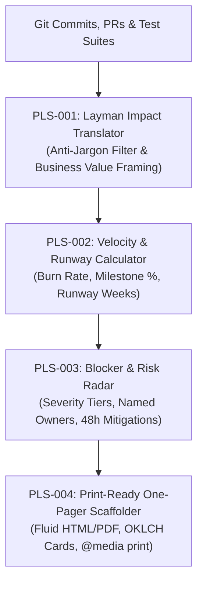

# executive-pulse — Autonomous C-Suite Weekly Briefing Generator

> **Council Lead**: **Crew** (Client Delivery Specialist) & **Jasper** (Creative Technologist & Copywriting Lead)  
> **Tooling**: `bun client-comms/scripts/executive-pulse.ts`  
> **Mode Command**: `/client-comms executive-pulse`  
> **Standards**: Layman Impact Translation (Zero Jargon), Velocity & Runway Tracking, 48h Risk Radar, Print-Ready HTML/PDF

---

## 💼 Purpose & Problem Statement

Agency clients and enterprise stakeholders are frequently overwhelmed by dense developer git commit logs, Jira tickets, and architectural jargon. When engineers communicate using internal acronyms (e.g. ORM, mTLS, SWR, DAG), C-suite executives struggle to perceive actual business ROI, leading to anxiety, micromanagement, and scope friction.

The `client-comms:executive-pulse` engine automatically translates technical git achievements into layman executive summaries, visualizes sprint velocity and budget runway, categorizes blockers with 48-hour proactive mitigation plans, and generates self-contained print-ready HTML one-pagers.

---

## 🏛️ Core Invariants



### 1. `PLS-001` — Layman Impact Translation
- Converts technical engineering milestones into clear, jargon-free business value summaries.
- Prohibits unexplained engineering acronyms (`ORM`, `mTLS`, `SWR`, `DAG`, `RPC`) and raw code snippets; translates every milestone into customer-facing or financial outcomes (e.g., faster load times, zero data loss, fraud reduction, increased sales conversion).

### 2. `PLS-002` — Sprint Velocity & Budget Runway Tracking
- Computes sprint velocity metrics:
  - Milestone completion percentage: $\frac{\text{Completed Milestones}}{\text{Total Milestones}} \times 100$.
  - Budget consumption against Total Contract Value (TCV).
  - Burn rate ($/week) and remaining financial runway in weeks ($\frac{\text{Budget Remaining}}{\text{Weekly Burn Rate}}$).

### 3. `PLS-003` — Blocker & Risk Radar
- Classifies project risks into `HIGH`, `MEDIUM`, or `LOW` priority.
- Enforces the **48-Hour Mitigation Invariant**: Every open blocker must name an explicit human owner and propose a concrete alternative or stop-the-clock memo within 48 hours.

### 4. `PLS-004` — Executive One-Pager HTML/PDF Scaffolding
- Scaffolds a single-page HTML report designed for instant C-suite consumption and print/PDF export:
  - Responsive fluid typography using modern CSS `clamp()`.
  - Accessible OKLCH color palettes with automatic dark-mode support.
  - Dedicated `@media print` rules ensuring clean margins and zero cutoff graphics.

---

## 💻 CLI Usage

```bash
# Generate terminal executive briefing for project
bun client-comms/scripts/executive-pulse.ts --project "Project Nexus" --client "Fintech Global"

# Export print-ready executive HTML one-pager
bun client-comms/scripts/executive-pulse.ts \
  --project "Sovereign Commerce Platform" \
  --client "Nordic Retail Group" \
  --export-html dist/executive-pulse.html

# Output structured JSON for client portals and dashboard widgets
bun client-comms/scripts/executive-pulse.ts --json
```

---

## 📋 Quality & Verification Gate

- [ ] Technical jargon replaced with clear layman business impacts.
- [ ] Sprint velocity and budget runway calculated mathematically.
- [ ] Every open risk assigned an explicit owner and 48-hour mitigation plan.
- [ ] HTML one-pager generated with valid syntax, fluid typography, and `@media print` styles.
