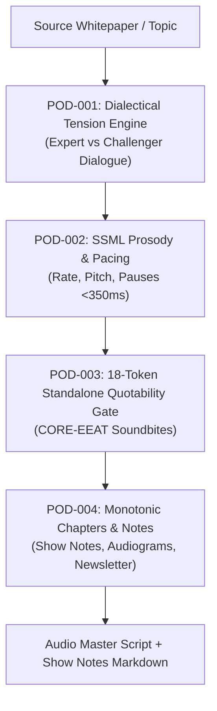

# podcast — AI Audio Showrunner & Dialogue Synthesis Engine

> **Council Lead**: **Jasper** (Creative Technologist & Growth Mastermind) & **Crew** (Client Delivery Specialist)  
> **Tooling**: `bun content/scripts/podcast-showrunner.ts`  
> **Mode Command**: `/content podcast`  
> **Standards**: Broadcast Audio (-16.0 LUFS), SSML Prosody, 18-Token Standalone Quotability Gate

---

## 🎙️ Purpose & Problem Statement

Agency clients demand high-engagement audio thought leadership and technical debate. However, manual podcast scripting, balancing host dynamics, and post-production show notes take days of back-and-forth.

The `content:podcast` engine automates the generation of dialectical multi-host audio scripts with natural conversational tension, annotated SSML prosody, strictly formatted monotonic chapters, and standalone 18-token soundbites primed for modern AI Engine Optimization (AEO) and audio search indexation.

---

## 🏛️ Core Invariants



### 1. `POD-001` — Two-Host Dialectical Tension
- Scripts pit a **Lead Expert** (deep architect/visionary) against a **Challenger / Co-Host** (pragmatic skeptic/inquirer).
- Dialogue avoids passive agreement; includes natural interjections (*"Hold on a second—"*, *"Let's push on that."*, *"Here's what I see in practice:"*).
- Balances speaking volume with an expert-to-challenger word count ratio between `0.6` and `2.0`.

### 2. `POD-002` — SSML Pacing & Emotion Annotation
- All spoken audio is annotated with W3C SSML tags (`<prosody rate="..." pitch="...">`, `<emphasis level="strong">`).
- **Breath Pause Ceiling**: Every inter-sentence `<break time="...ms"/>` is calibrated strictly below `350ms` (typically 150ms–320ms) to ensure brisk, engaging conversational tempo without unnatural silence.
- Pitch and rate variations reflect emotional arcs (`analytical`, `contrarian`, `curious`, `emphatic`, `reflective`).

### 3. `POD-003` — 18-Token Standalone Quotability Gate
- Key technical insights and soundbites must be self-contained within $\le 18$ words.
- Prohibits dangling referential pronouns (`"it"`, `"this"`, `"they"`, `"these"`) as the initial word of soundbites to maximize audio transcription searchability in Perplexity, Claude, and Gemini AI Overviews.

### 4. `POD-004` — Show Notes & Monotonic Chapter Scaffolding
- Auto-generates timestamped chapters in `[MM:SS]` format with strictly monotonic progression (`00:00`, `02:15`, `05:30`, etc.).
- Produces channel-ready repurposing collateral:
  - Episode overview & listener payoff.
  - Multi-platform audiogram visual waveform cues.
  - Newsletter tie-in teaser and key reference citations.

---

## 💻 CLI Usage

```bash
# Generate full podcast script and show notes
bun content/scripts/podcast-showrunner.ts --topic "High-Scale Microservices vs Monoliths" --duration 15m

# Scrape or ingest source whitepaper and export assets
bun content/scripts/podcast-showrunner.ts \
  --source docs/architecture.md \
  --host1 "Alex" \
  --host2 "Jordan" \
  --export-notes dist/shownotes.md \
  --export-ssml dist/master.ssml

# Structured JSON output for API or pipeline ingestion
bun content/scripts/podcast-showrunner.ts --topic "Sovereign AI Infrastructure" --json
```

---

## 📋 Quality & Verification Gate

- [ ] Two distinct host voices generated with authentic dialectical pushback.
- [ ] Cold Open hooks listener interest within the initial 45 seconds.
- [ ] SSML pauses strictly bounded below 350ms.
- [ ] At least 3 standalone 18-token quotable soundbites detected and verified.
- [ ] Chapter timestamps monotonically increasing with no negative deltas.
- [ ] Audio mastering target documented: `-16.0 LUFS` stereo / `-19.0 LUFS` mono, max `-1.0 dBTP`.
- [ ] Spoken vocal tracks filtered with high-pass filter at `80 Hz` to remove low-end rumble.
