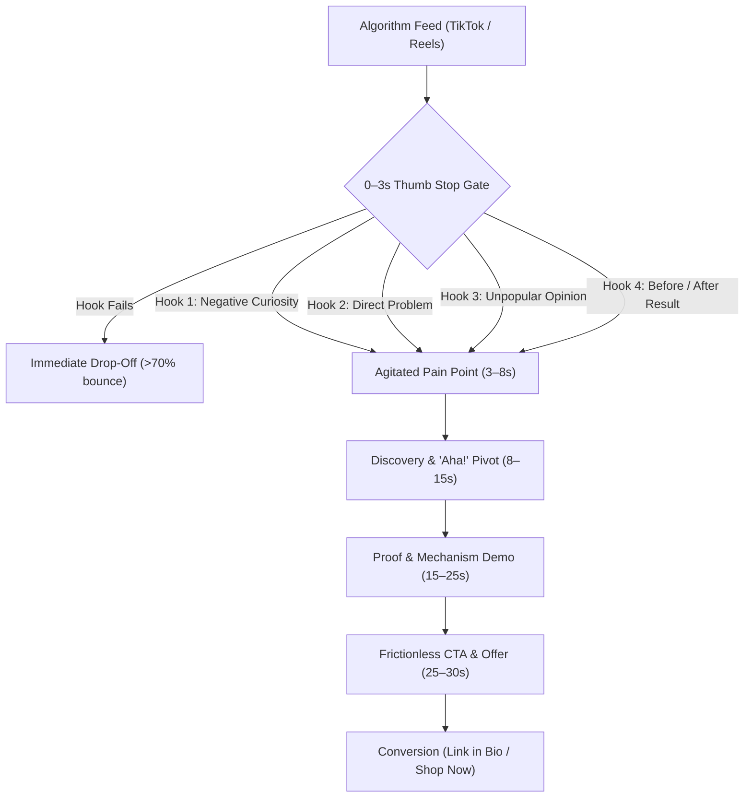

# ugc — Direct-Response UGC Video Scripts, 4-Hook Matrix, and Creator Briefs

> **Operating Principle**: Direct-response User-Generated Content (UGC) is the highest-volume creative engine in modern paid advertising (TikTok Spark Ads, Meta Reels, YouTube Shorts). Traditional polished studio commercials fail because users immediately recognize and skip ads. Winning UGC feels raw, unscripted, and native to the platform—yet is engineered with mathematical precision around thumb-stop hooks, fast visual pacing, and frictionless conversion.

---

## The UGC Direct-Response Architecture



---

## 🔒 The 4 Core UGC Invariants

Every UGC script, brief, and production deliverable authored under this skill must satisfy four non-negotiable invariants:

### 1. The 4-Hook Matrix for Algorithmic Split-Testing (UGC-001)
In paid social algorithms, creative fatigue is rapid and unpredictable. A single body script must be paired with **4 distinct opening hook variations** (0–3 seconds) shot separately by the creator:
1. **Negative Curiosity / Pattern Interrupt**: Directs the viewer to stop doing something harmful (*"Stop buying generic skincare until you check this ingredient..."*).
2. **Direct Problem Agitation**: Instantly qualifies the viewer by naming their exact daily frustration (*"If your client onboarding still takes 2 weeks in 2026, we need to talk..."*).
3. **Unpopular Opinion / Contrarian Stance**: Challenges conventional industry wisdom with high conviction (*"Unpopular opinion: hiring 3 more SDRs is actually destroying your agency margin..."*).
4. **High-Contrast Before & After / Result First**: Leads directly with the desirable payoff before showing the mechanism (*"Here's how I cut our cloud bill by 60% without touching Kubernetes..."*).

### 2. Jasper 5-Beat Narrative Storyboard Spine (UGC-002)
Winning 30–35 second vertical video scripts adhere strictly to this 5-beat emotional and cognitive spine:
- **Beat 1: The Hook (0:00–0:03)**: Extreme visual contrast or pattern interrupt + punchy verbal thesis + high-contrast text overlay.
- **Beat 2: Agitated Problem (0:03–0:08)**: Relatable struggle shown in raw Point-of-View (POV) or casual selfie mode; validates viewer frustration.
- **Beat 3: Discovery Pivot (0:08–0:15)**: Casual, unforced discovery (*"Then my teammate showed me..."*); unboxes or reveals interface without sales inflection.
- **Beat 4: Proof & Mechanism Demo (0:15–0:24)**: Screen capture or hands-on product demonstration showing the unique mechanism solving the problem in seconds.
- **Beat 5: Frictionless Call-to-Action (0:24–0:30+)**: One clear, direct action (discount code, link in bio) with urgency or scarcity.

### 3. Retention Pacing & 9:16 Vertical Safe Zones (UGC-003)
- **Cadence & Word Budget**: Spoken voiceover must maintain a natural, conversational delivery of **130–160 Words Per Minute (WPM)** (~70–90 spoken words for a 30s asset).
- **Visual Micro-Cuts**: Attention resets must occur every **2.0–3.5 seconds** via camera angle shifts, B-roll insertions, punch-in zooms, or split screens to counteract short-form platform drop-off.
- **9:16 Platform Safe Zone Compliance**: All on-screen text (OST), closed captions, and product logos must remain within the universal vertical safe zone:
  - *Top 15%*: Clear of platform search bars and live notifications.
  - *Bottom 20%*: Clear of user handles, sound titles, and native caption overlays.
  - *Right 15%*: Clear of like, comment, bookmark, and share icons.
- **Anti-Slop Authentic Language**: Zero corporate jargon or infomercial buzzwords (*"revolutionary"*, *"cutting-edge"*, *"game-changer"*, *"all-in-one"*, *"miracle"*). Must sound like a genuine recommendation between friends.

### 4. Production-Ready Creator Brief Export (UGC-004)
Every UGC campaign deliverable must include an exportable production brief for external content creators containing:
- Rigid technical specs (9:16 vertical, 1080p/4K @ 60fps, natural lighting, high-gain lapel audio).
- Clear DOs and DON'Ts (e.g. natural vocal inflection, no corporate speak, show product in the first 5 seconds).
- Complete shot lists and B-roll instructions.
- Native platform caption copy and targeted hashtag clusters.

---

## 🎬 Two-Column A/V Storyboard Template

| Scene & Time | Visual Direction (Column 1) | Spoken Audio & Voiceover (Column 2) |
| :--- | :--- | :--- |
| **Beat 1 (0:00–0:03)**<br>The Hook | **[Shot: Front-Facing Selfie, Rapid Punch-In Zoom]**<br>Creator looks directly into camera with expressive disbelief.<br>**[OST Safe Zone: "STOP DOING THIS 🛑"]** | *"If you're still manually tracking agency invoices in 2026, stop scrolling right now."* |
| **Beat 2 (0:03–0:08)**<br>Agitated Problem | **[Cut to: Point-of-View Angle]**<br>Laptop screen showing messy spreadsheets and 12 overdue notifications.<br>**[OST: "The worst feeling ever 😩"]** | *"I was literally spending all Sunday night chasing unpaid invoices instead of building."* |
| **Beat 3 (0:08–0:15)**<br>Discovery Pivot | **[Cut to: Creator at Desk]**<br>Creator casually turns laptop screen toward camera.<br>**[OST: "Found this life-saver ✨"]** | *"Then another founder told me about Accounts Flow. Honestly thought it was hype, but it completely fixed it."* |
| **Beat 4 (0:15–0:24)**<br>Proof & Demo | **[Cut to: Screen Recording Macro View]**<br>Showing automated dunning schedule and instant stripe payment receipt.<br>**[OST: "Paid in 12 minutes ⚡"]** | *"Look how simple this is. It triggers automated smart retries and locks in deposits before kick-off. Zero awkward follow-ups."* |
| **Beat 5 (0:24–0:30)**<br>Frictionless CTA | **[Cut to: Creator smiling into lens]**<br>Holding phone showing completed payment notification.<br>**[OST: "Use code FOUNDER20 👇"]** | *"Tap the link below right now to test the live demo and grab 20% off before the tier closes."* |

---

## 🛠️ UGC Generator CLI Tooling (`ugc-generator.ts`)

```bash
# 1. Scaffold a full 5-beat direct-response UGC script with 4-hook matrix
bun skills/agency-delivery/content/scripts/ugc-generator.ts \
  --scaffold-ugc \
  --product "FlowEngine" \
  --target "Growth Marketers" \
  --pain "broken attribution tracking" \
  --solution "server-side CAPI event piping" \
  --offer "Use code FLOW30 for 30% off" \
  --out ugc-script.md

# 2. Audit script compliance against UGC-001–UGC-004 invariants
bun skills/agency-delivery/content/scripts/ugc-generator.ts \
  --audit-script ugc-script.md \
  --duration-seconds 30

# 3. Analyze spoken cadence, visual cut frequency, and drop-off risks
bun skills/agency-delivery/content/scripts/ugc-generator.ts \
  --score-pacing \
  --product "FlowEngine" \
  --duration-seconds 30

# 4. Export creator production brief with technical specifications and DOs/DON'Ts
bun skills/agency-delivery/content/scripts/ugc-generator.ts \
  --export-brief \
  --product "FlowEngine" \
  --creator "Alex" \
  --out creator-brief.md
```

---

## 📊 Quality Verification Checklist

Before releasing any UGC script deliverable:
- [ ] 4 distinct opening hook variations provided for paid A/B testing (UGC-001).
- [ ] 5-beat storyboard sequence present (Hook $\rightarrow$ Problem $\rightarrow$ Pivot $\rightarrow$ Demo $\rightarrow$ CTA) (UGC-002).
- [ ] Spoken cadence verified between 130–160 WPM (UGC-003).
- [ ] Visual cuts or B-roll switches occur every 2.0–3.5 seconds (UGC-003).
- [ ] Visual cues explicitly specify 9:16 vertical safe zone boundaries (UGC-003).
- [ ] Banned corporate buzzwords eliminated (UGC-003).
- [ ] Complete creator technical brief with deliverable specs and DOs/DON'Ts exported (UGC-004).
