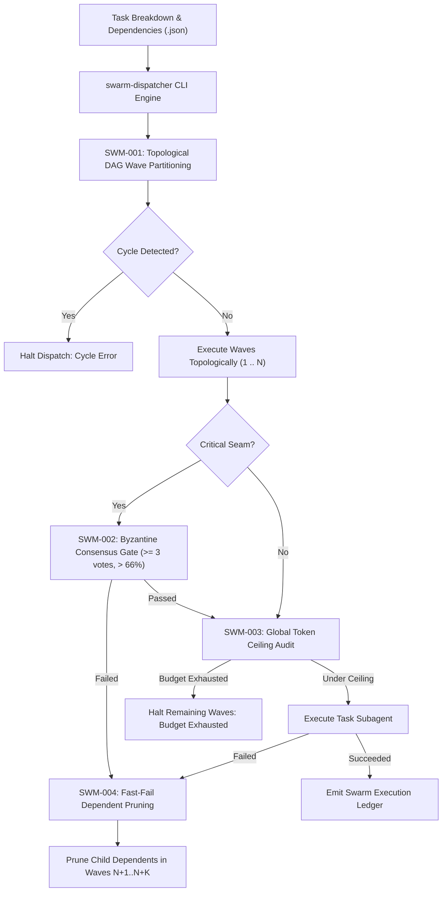

# swarm — Multi-Agent Consensus & DAG Wave Dispatcher

> **Operating Role**: Sol (Product Architect & Full-Stack Automator) & Nexus (Technical Director & Review Head)  
> **Direct Triggers**: "swarm dispatcher", "agent swarm", "byzantine consensus", "dag wave", "swarm consensus", "token budget arbiter", "multi-agent quorum"  
> **Core Directives**: SWM-001 through SWM-004  

The `swarm` mode transforms subagent execution from chaotic uncontrolled parallelism or slow sequential bottlenecks into mathematically coordinated, token-governed execution waves. It enforces topological DAG wave ordering, multi-agent Byzantine consensus gates on critical architectural seams, global session token budget ceilings, and fast-fail cascade pruning.

---

## The 4 Core Invariants (SWM-001 – SWM-004)



---

### SWM-001: Topological DAG Wave Partitioning & Cycle Detection

Uncontrolled agent parallelism risks write-write collisions and race conditions. `swarm-dispatcher` parses complex task graphs:

1. **In-Degree Wave Partitioning**:
   - Calculates dependency in-degrees for every task.
   - Groups tasks with zero unresolved dependencies into discrete parallel execution waves (`Wave 1`, `Wave 2`, $\dots$, `Wave N`).
   - Ensures all upstream tasks in wave $N$ reach `COMPLETED` before any task in wave $N+1$ is unlocked.
2. **Deterministic Cycle Detection**:
   - If circular dependencies exist (e.g. $A \to B \to A$), the topological sorter catches the cycle, reports the exact cyclic loop, and cleanly exits with code 1 before launching any subagent.

---

### SWM-002: Byzantine Consensus Quorum Gate

Not all tasks should be trusted to a single subagent. Database migrations, auth refactors, and core type definitions require verifiable quorum:

1. **Multi-Agent Voting Quorum**:
   - When `criticalSeam: true` is flagged, the dispatcher requires votes from at least 3 distinct Council leads (e.g. Sol, Nexus, Crew).
2. **66% Byzantine Agreement Gate**:
   - Requires strictly $> 66\%$ approval ($2/3$ majority) to pass. If the consensus threshold is not met, the task is marked `FAILED_CONSENSUS`, and downstream tasks dependent on it are safely pruned.

---

### SWM-003: Global Token Budget Arbiter

Unbounded autonomous swarms easily exhaust LLM context windows and API budgets:

1. **Session Token Ceiling**:
   - Enforces an absolute ceiling per swarm dispatch ($C_{\text{max}} \le 250,000$ tokens by default).
2. **Burn Rate Circuit Breaker**:
   - If remaining tokens cannot cover the estimated token appetite of an upcoming wave, the dispatcher safely pauses swarm execution, checkpoints unexecuted tasks, and alerts the operator.

---

### SWM-004: Fast-Fail Dependent Pruning

When a foundation task fails, continuing downstream tasks burns tokens for broken outcomes:

1. **Transitive Dependency Pruning**:
   - If task $X$ in Wave 1 fails, every task in subsequent waves that directly or transitively depends on $X$ is immediately marked `SKIPPED_UPSTREAM_FAILURE`.
2. **Audit Receipt Preservation**:
   - All skipped and failed tasks are logged to the swarm execution ledger with exact causality trails.

---

## 🛠️ CLI Usage & Practical Workflows

```bash
# 1. Topologically partition and dispatch a task DAG
bun skills/context-orchestration/coupling-router/scripts/swarm-dispatcher.ts \
  --plan tasks.json

# 2. Enforce a custom token ceiling and quorum requirement
bun skills/context-orchestration/coupling-router/scripts/swarm-dispatcher.ts \
  --plan tasks.json \
  --max-tokens 150000 \
  --quorum 3

# 3. Simulate swarm execution and emit JSON ledger
bun skills/context-orchestration/coupling-router/scripts/swarm-dispatcher.ts \
  --plan tasks.json \
  --simulate \
  --json
```

---

## 📊 Quality Verification Checklist

Before launching an autonomous agent swarm:
- [ ] Task graph verified acyclic with all dependencies resolvable (SWM-001).
- [ ] Critical architectural seams marked for Byzantine consensus voting (SWM-002).
- [ ] Aggregate estimated tokens within session ceiling ($C \le 250\text{k}$) (SWM-003).
- [ ] Dependent pruning tested on upstream failure cases (SWM-004).
