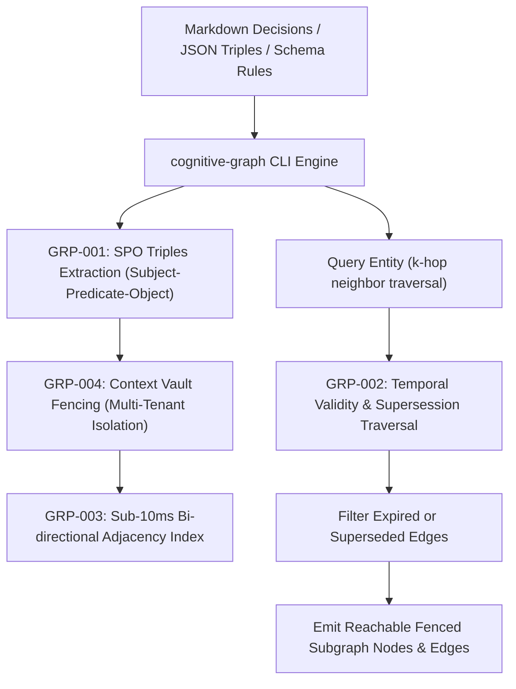

# graph — Bi-Directional Cognitive Knowledge Graph & Temporal Triples Engine

> **Operating Role**: Sol (Product Architect & Full-Stack Automator) & Muse (Chief Agency Orchestrator)  
> **Direct Triggers**: "database graph", "cognitive graph", "knowledge graph", "temporal triples", "entity graph", "graph traversal", "supersession edges", "fenced graph"  
> **Core Directives**: GRP-001 through GRP-004  

The `graph` mode enhances the database department with a high-speed, bi-directional in-memory knowledge graph engine. It parses natural-language architecture decisions, schema dependencies, and operational rules into formal Subject-Predicate-Object (SPO) triples, enforces temporal validity and supersession edge filtering, delivers sub-10ms graph traversals for prompt context injection, and cryptographically fences multi-tenant client entities.

---

## The 4 Core Invariants (GRP-001 – GRP-004)



---

### GRP-001: SPO Triples Extraction

Unstructured text fragments fail to preserve relational and semantic causality. `cognitive-graph` extracts structured triples:

1. **Formal Entity & Relation Mapping**:
   - Parses statements into standardized Subject-Predicate-Object entities: `(Subject)-[PREDICATE]->(Object)`.
   - Normalizes relational predicates (`DEPENDS_ON`, `SUPERSEDES`, `MIGRATED_TO`, `STORES`, `CONFIGURES`, `AUTHORS`).
2. **Confidence & Timestamp Ledger**:
   - Every triple records a confidence score ($0.0 \dots 1.0$), creation timestamp, and assigned tenant ID.

---

### GRP-002: Temporal Validity & Supersession Traversal

Static knowledge bases suffer from zombie facts and outdated design patterns:

1. **Supersession Edge Linking**:
   - When a technical standard or architecture decision is upgraded, the old triple receives a `supersededBy` reference pointing to the new confirmed fact.
2. **Temporal Edge Filtering**:
   - Graph queries automatically filter out expired (`validUntil < now()`) or superseded triples by default, guaranteeing agents never hallucinate deprecated patterns.

---

### GRP-003: Sub-10ms Graph Traversal

Context injection during agent prompt construction must not introduce latency:

1. **In-Memory Bi-Directional Adjacency Index**:
   - Maintains separate forward (`subject -> object`) and reverse (`object -> subject`) index sets in memory.
2. **Breadth-First $k$-Hop Traversal**:
   - Traverses $k$-hop neighborhoods (depth $1 \dots 4$) in $< 10\text{ms}$, returning full connected subgraphs without database disk I/O penalties.

---

### GRP-004: Context Vault Fencing

In a multi-client agency environment, cross-client data leakage is fatal:

1. **Strict Cryptographic Tenant Boundaries**:
   - Every query requires an explicit `tenantId`.
   - Adjacency lists strictly segregate triples by tenant; queries for Client A are physically incapable of traversing or returning Client B nodes.

---

## 🛠️ CLI Usage & Practical Workflows

```bash
# 1. Ingest triples from an architectural Markdown doc or JSON facts file
bun skills/agency-delivery/database/scripts/cognitive-graph.ts \
  --ingest architecture-decisions.md \
  --tenant client-alpha

# 2. Query 2-hop entity neighborhood for context injection
bun skills/agency-delivery/database/scripts/cognitive-graph.ts \
  --query "BetterAuth" \
  --tenant client-alpha \
  --depth 2 \
  --json

# 3. Mark an outdated architectural pattern superseded by a new standard
bun skills/agency-delivery/database/scripts/cognitive-graph.ts \
  --supersede "TRP-CLIENT-ALPHA-old1" \
  --with "TRP-CLIENT-ALPHA-new2"
```

---

## 📊 Quality Verification Checklist

Before injecting knowledge graph context into an active session:
- [ ] Triples validated with clean Subject, Predicate, and Object definitions (GRP-001).
- [ ] Superseded or expired decisions verified filtered from active traversal (GRP-002).
- [ ] Traversal benchmark completes in $< 10\text{ms}$ (GRP-003).
- [ ] Tenant boundaries strictly enforced with zero cross-tenant node leakage (GRP-004).
