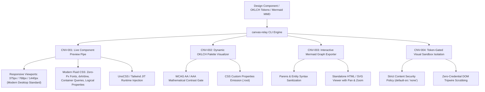

# canvas — Dynamic Visual Artifact Streaming & Canvas Relay Engine

> **Operating Role**: Jasper (Creative Technologist & Growth Mastermind) & Sol (Product Architect)  
> **Direct Triggers**: "design canvas", "canvas relay", "live component preview", "component preview pipe", "oklch visualizer", "mermaid export", "visual sandbox", "token-gated canvas", "stream visual artifact"  
> **Core Directives**: CNV-001 through CNV-004  

The `canvas` mode bridges generative AI coding and visual design fidelity. It streams live UI components, interactive OKLCH design token palettes, and Mermaid architectural diagrams into a CSP-isolated visual canvas sandbox, providing instant client previews without manual deployment cycles. It enforces modern web design standards: a **1440px** high-resolution widescreen desktop baseline, dynamic viewport units (`dvh`/`dvw`), container queries, and fluid typography with zero static pixel fonts.

---

## The 4 Core Invariants (CNV-001 – CNV-004)



---

### CNV-001: Live Component Preview Pipe & Modern Fluid Architecture

Eliminate blind code generation and fragile fixed-pixel styling. `canvas-relay` instantly renders generated UI components into a modern responsive preview harness:

1. **Multi-Viewport Real-Time Simulation (Modern Standards)**:
   - Generates isolated viewports for **Mobile** (`375px`), **Tablet** (`768px`), and **Desktop Standard** (`1440px` modern widescreen baseline, upgrading legacy 1280px).
   - Simulates component behavior across modern high-density screens, MacBooks (14"/16"), and 1440p monitors.
2. **Modern Fluid CSS Guidelines (>80% Browser Support, Baseline 2023/2024)**:
   - **Zero-Pixel Typography Mandate**: Never use hardcoded static `px` font sizes (`font-size: 16px`, etc.). All typography scales dynamically using `clamp()` calculations with `rem` and dynamic viewport units (`dvw` or `cqw`):
     - Fluid Base Text: `clamp(1rem, 0.95rem + 0.25dvw, 1.125rem)` (16px to 18px smoothly)
     - Fluid Heading 1: `clamp(2rem, 1.3rem + 3dvw, 3.25rem)` (32px to 52px)
     - Fluid Heading 2: `clamp(1.5rem, 1.1rem + 1.8dvw, 2.25rem)` (24px to 36px)
     - Fluid Heading 3: `clamp(1.25rem, 1rem + 1dvw, 1.75rem)` (20px to 28px)
     - Fluid Small / Caption: `clamp(0.75rem, 0.7rem + 0.2dvw, 0.875rem)` (12px to 14px)
     - Proportional unitless line heights: `1.15` for display headings, `1.5` to `1.65` for readable body copy.
   - **Dynamic Viewport Units (`dvh` & `dvw`)**: Replaces legacy `100vh` with `100dvh` (Dynamic Viewport Height) across preview viewports. Solves mobile address bar jumps on iOS Safari and Android Chrome with >92% global browser support.
   - **Container Queries & Units (`cqi` / `cqw`)**: Employs `container-type: inline-size` for true modular component-driven responsiveness, allowing components to adapt to their surrounding slot rather than the global window frame.
   - **Logical Properties**: Mandates logical box model properties for universal adaptability:
     - `inline-size` and `max-inline-size` (instead of `width` / `max-width`)
     - `min-block-size` and `block-size` (instead of `min-height` / `height`)
     - `padding-inline` and `padding-block` (instead of `padding-left/right`, `padding-top/bottom`)
     - `margin-inline: auto` (instead of `margin: 0 auto`)
   - **Pixel Dimension Prohibition**: Prohibits static `px` values for paddings, margins, gaps, widths, or radii. Allowed exceptions: hairline 1px borders (`border: 1px solid ...`) and sub-pixel box-shadow offsets.
3. **PostMessage Hot-Swap Bridge**:
   - Implements a bi-directional event listener (`type: 'CANVAS_UPDATE'`) allowing real-time hot-reloading of inner HTML without destroying iframe state or reloading network bundles.
4. **Runtime Utility Injection**:
   - Dynamically injects UnoCSS runtime for instant Tailwind v4 class evaluation without requiring local build compilation.

---

### CNV-002: Dynamic OKLCH Palette Visualizer

Perceptually uniform color is standard in modern design systems:

1. **Mathematical Contrast Verification**:
   - Evaluates lightness ($L$) and relative luminance contrast against light ($L \approx 0.98$) and dark ($L \approx 0.12$) canvas surfaces.
   - Enforces WCAG compliance: **AA** ($\ge 4.5:1$) and **AAA** ($\ge 7.0:1$) for all text and interactive accent tokens.
2. **Instant Design Token Export**:
   - Generates production-ready CSS custom properties block (`:root { --color-primary: oklch(...); }`) compatible with Tailwind/UnoCSS configurations.
   - Supports modern CSS `color-mix(in oklch, ...)` tokens for surface alpha and dynamic contrast fences.

---

### CNV-003: Interactive Mermaid Graph Exporter

Architectural diagrams communicate complex workflows to clients and teams:

1. **Syntax Hazard Prevention**:
   - Audits against common syntax pitfalls: unquoted parentheses inside node brackets (e.g. `id["Label (Extra)"]`), illegal unescaped HTML characters (`<`, `>`), and missing graph headers.
2. **Standalone Interactive Viewer**:
   - Bundles the Mermaid source into a standalone HTML viewer powered by Mermaid.js CDN with modern fluid CSS styling, dynamic viewport scaling (`100dvh`), and cross-browser zoom support.

---

### CNV-004: Token-Gated Visual Sandbox Isolation

Rendering dynamic HTML poses security and data leakage risks:

1. **Strict Content Security Policy (CSP)**:
   - Enforces `default-src 'none'; style-src 'unsafe-inline' https://cdn.jsdelivr.net; script-src 'unsafe-inline' https://cdn.jsdelivr.net; img-src 'self' data: https:;`.
   - Prevents unauthorized external network fetches, tracking beacons, and script exfiltration.
2. **DOM Credential Scrubbing Tripwire**:
   - Audits markup for leaked API keys (`sk-*`, `ghp_*`, private keys). If detected, triggers an immediate security alert and halts preview rendering.

---

## 🛠️ CLI Usage & Practical Workflows

```bash
# 1. Generate live responsive preview for a component (desktop defaults to 1440px modern widescreen)
bun skills/agency-delivery/design/scripts/canvas-relay.ts \
  --preview-component \
  --input hero-section.html \
  --viewport desktop \
  --output preview.html

# 2. Audit an OKLCH color palette for WCAG contrast compliance
bun skills/agency-delivery/design/scripts/canvas-relay.ts \
  --audit-palette \
  --input palette.json

# 3. Validate and export an interactive Mermaid architectural diagram
bun skills/agency-delivery/design/scripts/canvas-relay.ts \
  --export-mermaid \
  --input architecture.mmd \
  --output graph-viewer.html

# 4. Audit an exported canvas page for CSP fences and credential leaks
bun skills/agency-delivery/design/scripts/canvas-relay.ts \
  --audit-sandbox \
  --input preview.html
```

---

## 📊 Quality Verification Checklist

Before presenting any visual canvas artifact to a client:
- [ ] Responsive viewport preview verified at 375px mobile, 768px tablet, and 1440px desktop standard (CNV-001).
- [ ] Typography adheres to zero-pixel mandate, using fluid `clamp()` calculations with `rem` and dynamic viewport units (CNV-001).
- [ ] Dynamic viewport units (`100dvh` / `dvw`) and logical properties applied; no static pixel layouts (CNV-001).
- [ ] OKLCH color palette meets minimum WCAG AA contrast on both light and dark backgrounds (CNV-002).
- [ ] Mermaid diagrams pass syntax validation with quoted labels and valid headers (CNV-003).
- [ ] CSP meta header verified and zero credential tokens exposed in DOM (CNV-004).
