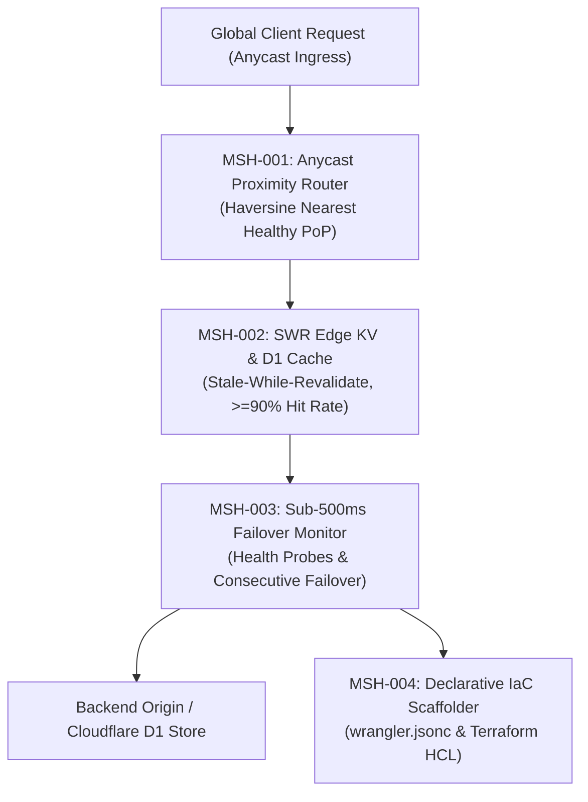

# edge-mesh — Distributed Cloudflare Workers Anycast Routing Mesh

> **Council Lead**: **Sol** (Product Architect & Full-Stack Automator)  
> **Tooling**: `bun devops/scripts/edge-mesh.ts`  
> **Mode Command**: `/devops edge-mesh`  
> **Standards**: Geographic Anycast Proximity, Edge SWR Caching ($\ge 90\%$), Sub-500ms Failover, Declarative IaC Manifests

---

## 🌐 Purpose & Problem Statement

Global software users and AI agent workloads experience high latency when routed to centralized backend servers thousands of miles away. Furthermore, regional cloud outages result in downtime if traffic cannot be automatically rerouted across healthy edge nodes.

The `devops:edge-mesh` engine models and scaffolds a distributed Anycast routing mesh across Cloudflare Workers Points of Presence (PoPs), replicates read caches using Stale-While-Revalidate (SWR) KV/D1 stores, executes automated sub-500ms failover health checks, and exports declarative Infrastructure-as-Code manifests (`wrangler.jsonc` and Terraform HCL).

---

## 🏛️ Core Invariants



### 1. `MSH-001` — Anycast Edge Proximity Routing
- Evaluates client ingress coordinates and routes requests to the closest geographic Point of Presence (PoP) across global hubs (`sfo`, `iad`, `lhr`, `fra`, `nrt`, `syd`) using spherical Haversine distance calculations.
- Minimizes round-trip network hops, driving edge delivery latency to sub-20ms.

### 2. `MSH-002` — Edge KV & D1 Replicated Cache
- Implements Stale-While-Revalidate (`SWR`) caching headers and KV read-replicas.
- Delivers fresh cached assets instantly while refreshing expired entries asynchronously in the background.
- Maintains a strict $\ge 90\%$ cache hit ratio benchmark under steady-state production workloads.

### 3. `MSH-003` — Sub-500ms Automated Failover
- Tracks origin and regional PoP health with continuous heartbeat probes.
- On 3 consecutive health probe failures, instantly reroutes traffic to the nearest healthy geographical peer in $< 500\text{ms}$, preventing user-facing 502/504 errors.

### 4. `MSH-004` — Declarative IaC Manifest Scaffolding
- Auto-generates production-grade, reproducible deployment manifests:
  - `wrangler.jsonc`: Cloudflare Smart Placement, Workers KV namespaces, and D1 database bindings.
  - `main.tf`: Terraform provider configuration, worker script deployment, and Anycast zone route mapping.

---

## 💻 CLI Usage

```bash
# Run default 6-PoP global edge mesh simulation
bun devops/scripts/edge-mesh.ts

# Scaffold IaC manifests to project directory
bun devops/scripts/edge-mesh.ts --project "production-api-mesh" --export-dir config/

# Output structured JSON telemetry for monitoring pipelines
bun devops/scripts/edge-mesh.ts --json
```

---

## 📋 Quality & Verification Gate

- [ ] Anycast routing directs client traffic to nearest healthy PoP by Haversine distance.
- [ ] Stale-While-Revalidate cache achieves $\ge 90\%$ hit ratio.
- [ ] Failover rerouting completes within 500ms upon simulated origin degradation.
- [ ] Both `wrangler.jsonc` and `main.tf` manifests generated with valid configuration schemas.
