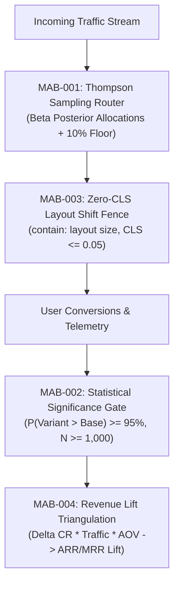

# programmatic-cro — Multi-Armed Bandit Dynamic Optimization Engine

> **Council Lead**: **Jasper** (Creative Technologist & Growth Mastermind) & **Nexus** (Technical Director & Review Head)  
> **Tooling**: `bun growth/scripts/bandit-cro.ts`  
> **Mode Command**: `/growth programmatic-cro`  
> **Standards**: Bayesian Thompson Sampling, Zero-CLS Fences ($CLS \le 0.05$), Statistical Significance ($P \ge 95\%$)

---

## 🎯 Purpose & Problem Statement

Traditional static A/B testing wastes marketing budget by routing 50% of traffic to inferior variants for weeks until statistical power is reached. Furthermore, ad hoc client-side testing scripts frequently inject severe Cumulative Layout Shift (CLS), damaging SEO rankings and eroding user trust.

The `growth:programmatic-cro` engine deploys Bayesian Multi-Armed Bandit (MAB) Thompson Sampling to dynamically shift traffic toward winning headline, offer, and CTA variants in real-time, while enforcing layout containment fences and mathematical revenue lift triangulation.

---

## 🏛️ Core Invariants



### 1. `MAB-001` — Bayesian Thompson Sampling
- Implements Beta-Binomial conjugate priors:
  $$\theta_i \sim \text{Beta}(\alpha_i, \beta_i) \quad \text{where} \quad \alpha_i = \text{conversions} + 1, \; \beta_i = \text{impressions} - \text{conversions} + 1$$
- Runs Monte Carlo draws to estimate the posterior probability that variant $i$ is optimal ($P(\theta_i = \max_j \theta_j)$).
- **Exploration Floor**: Guarantees a minimum traffic allocation of `10%` to all active variants to prevent premature convergence or false local maxima.

### 2. `MAB-002` — Statistical Significance Gate
- Variant promotion requires:
  1. Posterior probability $P(\theta_k > \theta_0) \ge 95\%$ over baseline $\theta_0$.
  2. Sample size threshold $N_k \ge 1,000$ and $N_0 \ge 1,000$ to filter low-volume anomalies.
- Flags variants under evaluation as `COLLECTING_DATA`, `WINNER`, or `LOSING`.

### 3. `MAB-003` — Zero-CLS Variant Hydration
- Audits variant DOM structures for layout containment:
  - Requires CSS `contain: layout size` or reserved `min-height` fences on dynamic headlines.
  - Mandates explicit `aspect-ratio` on hero media and dynamic graphics.
  - Rejects variants where synthetic or RUM $CLS > 0.05$.

### 4. `MAB-004` — Revenue Lift Triangulation
- Converts conversion rate deltas directly into audited financial impact:
  $$\Delta \text{MRR} = \text{Monthly Unique Visitors} \times (\text{CR}_k - \text{CR}_0) \times \text{AOV}$$
  $$\Delta \text{ARR} = 12 \times \Delta \text{MRR}$$
- Emits quantified executive business cases for client C-suite sign-off.

---

## 💻 CLI Usage

```bash
# Run default benchmark experiment evaluation
bun growth/scripts/bandit-cro.ts

# Evaluate custom experiment dataset with 95% confidence threshold
bun growth/scripts/bandit-cro.ts \
  --evaluate-variants data/experiments.json \
  --confidence 0.95 \
  --traffic 100000 \
  --aov 200

# Structured JSON output for automated traffic router integration
bun growth/scripts/bandit-cro.ts --evaluate-variants data/experiments.json --json
```

---

## 📋 Quality & Verification Gate

- [ ] Thompson Sampling maintains minimum 10% exploration floor for all variants.
- [ ] Winner status restricted to variants with $P \ge 95\%$ and $N \ge 1,000$.
- [ ] Zero layout shift violations ($CLS \le 0.05$) across all tested viewports.
- [ ] Direct financial ROI and MRR/ARR impact quantified from conversion delta.
