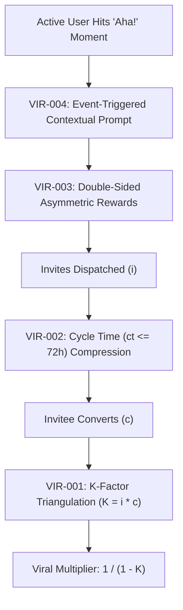

# viral — Viral Loop Coefficient & Referral Mechanics Engine

> **Operating Role**: Jasper (Agency Council Creative Technologist & Growth Mastermind)  
> **Direct Triggers**: "viral loop", "viral coefficient", "k factor", "referral loop", "viral mechanics", "cycle time compression", "invitation rate", "viral growth model", "k-factor calculator"  
> **Core Directives**: VIR-001 through VIR-004  

The `viral` mode establishes Jasper's mathematical Viral Loop and Referral Engine. It formalizes viral growth dynamics ($K = i \times c$), cycle time ($ct$) compression, asymmetric double-sided incentive architectures, and event-triggered referral placements to turn product usage into compounding customer acquisition.

---

## The 4 Core Invariants (VIR-001 – VIR-004)



### VIR-001: Mathematical $K$-Factor Triangulation & Loop Dynamics
Every viral program must be mathematically modeled before engineering referral widgets or incentive budgets:

$$K = i \times c$$

- **$i$ (Invitation Rate)**: Average number of referral invitations, shared links, or collaboration requests sent per active user.
- **$c$ (Conversion Rate)**: Percentage of recipients who click the invite, complete onboarding, and become activated users.
- **$K$ (Viral Coefficient)**:
  - **$K \ge 1.0$ (True Virality)**: Exponential viral growth where every cohort generates a larger succeeding cohort without incremental acquisition spend.
  - **$K < 1.0$ (Viral Amplification Multiplier)**: The organic multiplier on top of baseline marketing channels (paid, organic, sales):
    $$\text{Acquisition Multiplier} = \frac{1}{1 - K}$$
    *(e.g., $K = 0.5 \implies 2.0\times$ multiplier; every 1,000 paid acquisitions yields 1,000 additional organic users; $K = 0.75 \implies 4.0\times$ multiplier).*
- **Hard Floor**: Minimum viable amplification threshold is $K \ge 0.15$ ($1.18\times$ lift). Any program yielding $K < 0.15$ must be restructured or killed to avoid UI clutter.

### VIR-002: Viral Cycle Time ($ct$) Compression Fences
The speed at which viral compounding occurs is governed by the Cycle Time ($ct$) — the total elapsed duration from when a new prospect receives an invitation to when they send their own invitations downstream:

$$N_t = N_0 \times (1 + K)^{t / ct}$$

1. **Cycle Time Mandate**: Cycle time must remain $\le 72\text{ hours}$ (agency target $\le 24\text{ hours}$). If $ct$ drags to 30 days, viral momentum collapses even with a healthy $K$-factor.
2. **Zero-Friction Invitee Landing**:
   - Pre-fill referrer identification tokens in deep links.
   - Banish mandatory credit card capture or 12-field registration forms on referral landings.
   - Instantly apply credits or unlock benefits upon magic-link / SSO login.
3. **In-Product Micro-Loops**:
   - Embed organic share loops directly inside natural collaborative workflows (e.g., "Invite teammate to view dashboard", "Share view-only report", "Collaborate on document").

### VIR-003: Double-Sided Asymmetric Incentive Architecture
Referral programs fail when incentives are symmetric cash discounts that attract low-intent bonus hunters and invite fraud.

1. **Invitee Reward (Immediate Gratification)**:
   - Provide instant, high-perceived-value product utility: free first month, $50 in API credits, or priority onboarding.
2. **Inviter Reward (Milestone & Activation Gated)**:
   - Unlock the inviter reward **only** after the invited user completes a verified "Activation Milestone" (e.g., publishes first project, spends first $50, or remains active for 14 days).
   - Never credit rewards on raw email signups.
3. **Sybil & Fraud Defense Guardrails**:
   - Device and browser fingerprinting to prevent self-referrals.
   - Disposable temporary email domain blacklist.
   - Velocity rate limits: maximum 10 paid referral conversions per user per 24 hours without human verification.

### VIR-004: Contextual "Aha!" Trigger Placement (Zero Cold Asks)
The timing of the referral ask dictates the invitation rate ($i$):

1. **The Cold-Ask Ban**:
   - Never prompt a user to refer colleagues during initial signup, account setup, or empty state views.
   - Asking before delivering value induces negative sentiment and yields $i < 0.05$.
2. **Dopamine Peak Triggers**:
   - **Trigger 1 (Creation / Export Success)**: Immediately following a high-satisfaction milestone (e.g., website published, code audited with 0 defects, campaign launched).
   - **Trigger 2 (Delight Support Event)**: Triggered 60 seconds after a user rates a support ticket 5/5.
   - **Trigger 3 (Value Receipt Delivery)**: Triggered upon delivery of monthly ROI receipts or milestone completion summaries.

---

## Viral Growth Metrics & Heuristic Rubric

| Metric | Target (Elite) | Acceptable | Failing (Redesign) | Remedy |
|:---|:---|:---|:---|:---|
| **$K$-Factor** | $\ge 0.60$ ($2.5\times$ lift) | $0.25 - 0.59$ ($1.33\times - 2.4\times$) | $< 0.15$ ($< 1.18\times$) | Increase invite visibility and boost invitee incentives |
| **Cycle Time ($ct$)** | $\le 24\text{ hours}$ | $25 - 72\text{ hours}$ | $> 7\text{ days}$ | Remove signup friction; introduce in-product collaborative prompts |
| **Invitation Rate ($i$)** | $\ge 2.5\text{ invites/user}$ | $1.0 - 2.4$ | $< 0.5$ | Relocate trigger to post-success "Aha!" moments |
| **Conversion Rate ($c$)** | $\ge 25\%$ | $12\% - 24\%$ | $< 8\%$ | Optimize invite landing page; remove upfront payment walls |
| **Fraud Rejection Rate** | $< 2\%$ | $2\% - 5\%$ | $> 10\%$ | Enforce milestone-gated inviter rewards and fingerprinting |

---

## Automated Inspection via `viral-engine.ts` CLI

Run Jasper's viral mechanics and loop simulation CLI directly:

```bash
# Calculate K-factor and acquisition multiplier
bun skills/agency-delivery/growth/scripts/viral-engine.ts --calc-k --invites 3.2 --conversion 0.18 --json

# Run 90-day viral loop simulation across cohort horizons
bun skills/agency-delivery/growth/scripts/viral-engine.ts --simulate-loop --users 1000 --k 0.45 --cycle-days 3 --horizon-days 90 --json

# Audit referral program configuration against VIR-001 - VIR-004
bun skills/agency-delivery/growth/scripts/viral-engine.ts --audit-referral config/referral.json --json

# Scaffold tailored double-sided incentive schedule
bun skills/agency-delivery/growth/scripts/viral-engine.ts --scaffold-incentives --model saas --output docs/referral-spec.md
```
