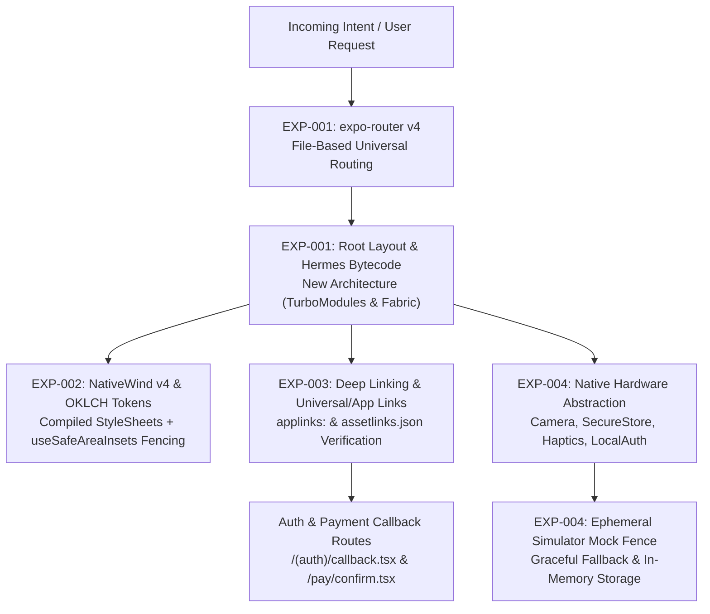

# expo — Universal Mobile App & Expo SDK 52 Architecture

> **Operating Role**: Sol (Agency Council Product Architect & Full-Stack Automator)  
> **Direct Triggers**: "expo", "expo sdk 52", "expo app", "expo router", "nativewind", "react native expo", "universal mobile app", "expo scaffold", "hermes bytecode"  
> **Core Directives**: EXP-001 through EXP-004  

The `expo` mode delivers production-grade universal mobile applications powered by Expo SDK 52, React Native New Architecture, `expo-router` v4 file-based navigation, NativeWind v4 design token styling, verified deep link routing, and hardware abstraction mocking fences.

---

## The 4 Core Invariants (EXP-001 – EXP-004)



### EXP-001: Modern Expo SDK 52 Universal Architecture
1. **File-Based Routing via `expo-router` v4**:
   - Universal navigation tree rooted in `app/` directory with typed routes (`experiments.typedRoutes: true`).
   - Root layout (`app/_layout.tsx`) wraps the application in `SafeAreaProvider`, theme contexts, and splash screen coordinator (`expo-splash-screen`).
   - Nested route groups `(tabs)` and `(auth)` prevent URL leaking and provide isolated stack transitions.
2. **Hermes Bytecode Engine**:
   - Mandatory `jsEngine: "hermes"` configured across iOS and Android profiles in `app.json`.
   - Ahead-of-time (AOT) bytecode compilation delivers sub-150ms Time-to-Interactive (TTI) and reduced memory footprints.
3. **React Native New Architecture**:
   - Explicit `newArchEnabled: true` in `app.json` enabling TurboModules (direct C++ native bindings) and Fabric (concurrent native renderer).
   - Zero bridge serialization overhead for high-frequency gesture and animation loops.
4. **Platform Minimum Targets & Edge-to-Edge Display**:
   - **Android 15**: Mandatory edge-to-edge support (`android.edgeToEdge: true` in `app.json`) drawing under status bars and navigation gesture bars with transparent styling.
   - **iOS**: Minimum deployment target locked to iOS 15.1+ (`ios.deploymentTarget: "15.1"`).

### EXP-002: NativeWind v4 & OKLCH Theme Integration
1. **Compile-Time Styling**:
   - NativeWind v4 compiler compiles Tailwind utility classes directly into native React Native StyleSheets at build time with zero runtime CSS-in-JS parsing penalty.
   - Babel preset (`nativewind/babel`) and Metro transformer (`nativewind/metro`) properly configured.
2. **Safe Area Insets Fencing**:
   - Hardcoded top/bottom padding or manual notch height calculations are strictly prohibited.
   - Safe area boundaries must be consumed via `useSafeAreaInsets()` from `react-native-safe-area-context` or NativeWind's `safe-area-*` primitives.
3. **OKLCH Design Token Mapping**:
   - Agency design tokens mapped to CSS variables supporting automatic light and dark mode toggling (`colorScheme: "system" | "dark" | "light"`).
   - Touch targets for interactive elements must enforce a minimum $44 \times 44\text{pt}$ hit slop on iOS and $48 \times 48\text{dp}$ on Android.

### EXP-003: Deep Linking & Universal Links / App Links Architecture
1. **Custom Scheme**:
   - Explicit `scheme: "<app-slug>"` defined in `app.json` for internal protocol redirection (e.g. `myapp://profile/123`).
2. **iOS Universal Links (`applinks`)**:
   - Configured via `ios.associatedDomains: ["applinks:<domain>"]`.
   - Two-way verification verified against host domain `https://<domain>/.well-known/apple-app-site-association` declaring `appIDs: ["<TEAM_ID>.<BUNDLE_ID>"]`.
3. **Android App Links (`assetlinks`)**:
   - Configured via `android.intentFilters` with `autoVerify: true`, action `android.intent.action.VIEW`, data scheme `https`, and data host.
   - Verified against `https://<domain>/.well-known/assetlinks.json` declaring matching package name and SHA-256 certificate fingerprints.
4. **Auth & Payment Callback Routes**:
   - Dedicated callback handlers placed under `app/(auth)/callback.tsx` (OAuth tokens, PKCE code exchange) and `app/pay/confirm.tsx` (Stripe/RevenueCat redirect verification).
   - Enforce query parameter sanitization, state verification, and safe navigation dispatch.

### EXP-004: Native Hardware Access & Ephemeral Mocking Fences
1. **Permitted Native Packages**:
   - Secure Credential Storage: `expo-secure-store` (iOS Keychain / Android Keystore).
   - Biometric Authentication: `expo-local-authentication` (FaceID, TouchID, BiometricPrompt).
   - Physical Feedback: `expo-haptics` (`impactAsync`, `notificationAsync`).
   - Media & Camera: `expo-camera` with explicit runtime permission checks (`requestCameraPermissionsAsync`).
2. **Simulator & Test Mock Fences**:
   - Every hardware API wrapper must include an ephemeral mock fence fallback when running in simulator environments or headless CI:
     ```typescript
     import * as LocalAuthentication from "expo-local-authentication";
     import * as SecureStore from "expo-secure-store";
     import { Platform } from "react-native";

     export async function authenticateBiometrics(): Promise<boolean> {
       if (Platform.OS === "web" || !await LocalAuthentication.hasHardwareAsync()) {
         // Ephemeral mock fence for simulators and web test runners
         return process.env.NODE_ENV !== "production";
       }
       const result = await LocalAuthentication.authenticateAsync({
         promptMessage: "Authenticate to unlock",
         fallbackLabel: "Use Passcode",
       });
       return result.success;
     }
     ```
   - Ephemeral in-memory key-value fallback when `SecureStore.isAvailableAsync()` returns `false`.

---

## Architecture Comparison

| Architectural Dimension | Expo SDK 52 (New Architecture) | Legacy React Native (Bridge) | Pure Native (SwiftUI / Compose) | Progressive Web App (PWA) |
| :--- | :--- | :--- | :--- | :--- |
| **Runtime & JS Engine** | Hermes Bytecode + C++ TurboModules | JSC / Hermes over JSON Bridge | Native LLVM / JVM Bytecode | Browser V8 / WebKit |
| **Rendering Pipeline** | Fabric Concurrent Renderer (Direct C++) | Asynchronous Bridge Batching | Direct Metal / Skia rendering | DOM / CSS Layout Engine |
| **Routing Model** | `expo-router` v4 (File-based, typed) | `react-navigation` (Imperative) | `NavigationStack` / Compose Nav | Window History API / URL |
| **Styling Strategy** | NativeWind v4 (Compiled StyleSheets) | StyleSheet.create / Emotion | Declarative Swift / Compose modifiers | Standard CSS3 / Tailwind |
| **Deep Link Verification** | Universal Links + Android App Links | Manual `Linking` & Manifest surgery | Built-in Universal Links & Intent Filters | Browser URLs & Web App Manifest |
| **Hardware Abstraction** | Expo Modules API + Ephemeral Fences | Unmaintained third-party bridges | Direct SDK frameworks (`LocalAuthentication`) | Web APIs (limited permissions) |
| **Build & Deploy** | EAS Build / Run CLI + OTA Updates | Manual Fastlane & Xcode/Gradle | Xcode Cloud / Fastlane | Instant Web Deploy / CDN |

---

## Standard Project Layout

```text
mobile-app/
├── app/
│   ├── _layout.tsx           # Root layout: SafeAreaProvider, Theme, Splash
│   ├── index.tsx             # Home landing screen
│   ├── (auth)/
│   │   ├── login.tsx         # Authentication screen
│   │   └── callback.tsx      # Deep link auth handler (EXP-003)
│   ├── (tabs)/
│   │   ├── _layout.tsx       # Bottom tab bar coordinator
│   │   ├── home.tsx          # Main dashboard
│   │   └── settings.tsx      # User settings & hardware controls
│   └── pay/
│       └── confirm.tsx       # Payment confirmation deep link (EXP-003)
├── components/
│   ├── hardware-fence.tsx    # Ephemeral simulator mock wrappers (EXP-004)
│   └── safe-screen.tsx       # Native safe-area wrapper (EXP-002)
├── app.json                  # Expo SDK 52 config (EXP-001 & EXP-003)
├── package.json              # NativeWind v4 & Expo 52 dependencies
├── tailwind.config.js        # OKLCH color token mappings (EXP-002)
└── global.css                # NativeWind styles & Tailwind directives
```

---

## Automated Inspection via `expo-scaffold.ts` CLI

Run Sol's Expo SDK 52 scaffolding, configuration audit, and deep link verification CLI directly:

```bash
# 1. Scaffold a fresh Expo SDK 52 project structure
bun skills/agency-delivery/mobile/scripts/expo-scaffold.ts \
  --scaffold-app \
  --name "Nova App" \
  --slug "nova-app" \
  --scheme "novaapp" \
  --bundle-id "com.agency.nova" \
  --output ./apps/nova-app \
  --json

# 2. Audit an existing app directory or app.json against EXP-001 - EXP-004
bun skills/agency-delivery/mobile/scripts/expo-scaffold.ts \
  --audit-app ./apps/nova-app \
  --json

# 3. Verify deep links, universal links, and Android app links
bun skills/agency-delivery/mobile/scripts/expo-scaffold.ts \
  --verify-deep-links ./apps/nova-app/app.json \
  --json
```

---

## Quality Gate Checklist

- [ ] `app.json` has `newArchEnabled: true` and `jsEngine: "hermes"`.
- [ ] Android 15 edge-to-edge configured via `android.edgeToEdge: true`.
- [ ] iOS minimum deployment target is $\ge 15.1$.
- [ ] NativeWind v4 setup compiles Tailwind styles without runtime lag.
- [ ] Safe areas managed exclusively via `useSafeAreaInsets` or NativeWind safe area utilities.
- [ ] Deep linking configured with both custom scheme and universal links (`associatedDomains` + `intentFilters`).
- [ ] Hardware access routines (Camera, Biometrics, SecureStore) implement ephemeral simulator fences.
- [ ] CLI audit passes with `PASS` verdict ($\ge 75/100$ health score).
