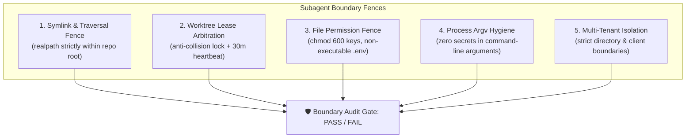

# 🛡️ muse-security:boundary — Subagent Tenant Boundary & Worktree Isolation Auditor

> Single-source agency standard for autonomous subagent sandboxing, filesystem permission fences, shared git worktree lease arbitration, and multi-tenant isolation.

---

## 1. Executive Doctrine & Architectural Scope

In agentic agency delivery, autonomous subagents (spawned by OpenCode, Gemini/Antigravity, Windsurf, Claude Code, or Hermes) execute parallel code modifications, refactors, and test runs. Without deterministic boundary enforcement, subagents risk:
1. **Filesystem Traversal & Symlink Escapes**: Traversing parent paths (`../`) or dereferencing symlinks that escape into host system paths (`~/.ssh`, `/etc/`, host dotfiles) or other client directories.
2. **Shared Worktree Leases & State Collisions**: Modifying files or switching branches in a shared checkout without lease coordination, corrupting git index state.
3. **Insecure Permissions**: Creating or leaving credentials, private keys, or `.env` files with world-readable permission bits (`chmod 644` / `777`).
4. **Process Argv Token Leakage**: Passing secrets, API keys, or database URLs directly as CLI arguments (`argv`), exposing tokens to `ps aux`, process tables, and system logs.
5. **Multi-Tenant Cross-Contamination**: Reading Client B assets from a subagent assigned to Client A.

`muse-security:boundary` acts as the independent security gate auditing and enforcing subagent containment.

---

## 2. The 5 Core Boundary Invariants



### Invariant 1: Symlink & Path Traversal Fence
- Every symlink within the workspace must resolve (`fs.realpathSync`) to a target located **strictly inside** the workspace root.
- Dangling symlinks pointing to nonexistent targets or outside paths are flagged as critical vulnerabilities.
- Relative traversal patterns (`../` or encoded `..%2f`) in subagent configuration paths are prohibited.

### Invariant 2: Shared Git Worktree Lease Arbitration
- When multiple subagents or background processes operate within one repository, each subagent modifying working state must register an active lease in `.agents/worktree-leases/<branch-or-task>.json`.
- A lease specifies: `holder` (agent ID/process ID), `branch`, `worktreePath`, `acquiredAt`, and `lastHeartbeat`.
- Leases are considered stale after **30 minutes** without heartbeat renewal, permitting clean reclamation without manual intervention.
- Two agents must never write to the same branch or checkout simultaneously.

### Invariant 3: File Permission Fences (POSIX)
- **Private Keys & Certificates** (`*.pem`, `*.key`, `id_rsa`, `id_ed25519`): Must have file permissions `<= 0600` (`-rw-------` or `-r--------`). Any group or world readability (`0644`, `0664`, `0777`) is an immediate critical violation.
- **Environment Files** (`.env`, `.env.local`): Must never have execute permissions (`-x`). Must be listed in `.gitignore`.
- **Scripts** (`scripts/*.sh`, `scripts/*.ts`): Executable by owner/group only (`0755` or `0700`), never world-writable (`0777`).

### Invariant 4: Process Argv Credential Hygiene
- Subagents must never pass raw secret tokens (`sk-*`, `ghp_*`, passwords, private keys, database connection strings) via CLI arguments or process flags (e.g. `curl -u user:password`, `node script.js --token=sk-...`).
- CLI invocations visible in `ps aux` or command history must ingest secrets via environment variables (`process.env`) or securely mapped temp files, never command-line arguments.

### Invariant 5: Multi-Tenant Workspace Isolation
- In agency monorepos or multi-client hosts, subagents operate strictly within their scoped sub-app directory (e.g. `clients/client-a/`).
- Writes to parent directories, sibling client directories, or global configurations require explicit supervisor escalation.

---

## 3. Boundary Audit Engine (`boundary-audit.ts`)

The boundary audit CLI provides deterministic verification for CI pipelines, pre-commit hooks, and subagent supervisory gates.

### Usage:
```bash
# Full boundary audit of the current workspace
bun skills/quality-review/muse-security/scripts/boundary-audit.ts

# Audit specific workspace directory
bun skills/quality-review/muse-security/scripts/boundary-audit.ts --path ./projects/client-a

# Emit machine-readable JSON report
bun skills/quality-review/muse-security/scripts/boundary-audit.ts --json

# Run specific boundary checks
bun skills/quality-review/muse-security/scripts/boundary-audit.ts --check-symlinks --check-permissions
```

---

## 4. Remediation Playbook

| Finding ID | Severity | Root Cause | Automated Remediation |
| :--- | :--- | :--- | :--- |
| **BND-001** | `CRITICAL` | Symlink escapes workspace root | Remove escaping symlink (`rm <link>`) or replace with internal copy. |
| **BND-002** | `CRITICAL` | Stale or colliding worktree lease | Release expired lease (`bun coupling-router/scripts/worktree-lease.ts release`) or isolate to new worktree. |
| **BND-003** | `CRITICAL` | Insecure private key permissions | Enforce strict permissions: `chmod 600 <key_file>`. |
| **BND-004** | `WARNING` | Executable `.env` file | Remove execute bit: `chmod -x .env`. |
| **BND-005** | `CRITICAL` | Credential passed in process argv | Refactor subagent command invocation to read from `process.env`. |
| **BND-006** | `CRITICAL` | Cross-client directory traversal | Quarantine subagent execution to assigned workspace path. |

---

## 5. Verification Checklist

Run before claiming completion of any subagent or workspace task:
- [ ] Symlink containment verified: zero symlinks resolve outside repository root.
- [ ] Shared worktree lease clean: zero conflicting checkouts on target branch.
- [ ] Permissions verified: all private keys and sensitive assets are `chmod 600` or strictly user-isolated.
- [ ] Command arguments scrubbed: zero secrets exposed in process argv.
- [ ] Multi-tenant isolation respected: zero writes outside the target client boundary.
