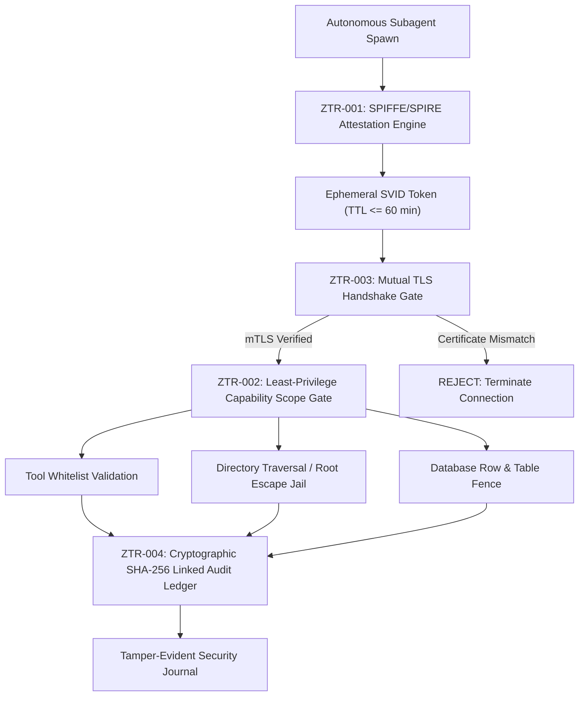

# zero-trust — Ephemeral Mutual TLS & Subagent Identity Attestation

> **Operating Role**: Nexus (Technical Director) & Sol (Product Architect)  
> **Direct Triggers**: "zero trust", "spiffe", "spire", "subagent attestation", "mtls", "capability scope", "least privilege", "tamper evident audit"  
> **Core Directives**: ZTR-001 through ZTR-004  
> **Primary Tooling**: `skills/quality-review/muse-security/scripts/zero-trust.ts`

The `zero-trust` mode establishes cryptographic identity attestation, fine-grained capability isolation, and mutual TLS (mTLS) for all autonomous AI subagents operating within the agency ecosystem. Under zero-trust architecture, no subagent or process is trusted by default—every invocation requires a verifiable SPIFFE Verifiable Identity Document (SVID), scoped permission limits, and cryptographic audit logging.

---

## The 4 Core Invariants (ZTR-001 – ZTR-004)



---

### ZTR-001: SPIFFE/SPIRE Identity Attestation
- **Identity Standard**: Every executing subagent is issued an ephemeral SPIFFE ID structured as:
  ```text
  spiffe://agency.muse/subagent/<role>-<random-id>
  ```
- **Validity Ceiling**: Token time-to-live (TTL) is strictly bounded ($\le 60\text{ minutes}$). Expired tokens are immediately rejected by all API endpoints and inter-agent buses.
- **Cryptographic Fingerprinting**: Tokens carry a SHA-256 payload digest and an HMAC signature derived from the root attestation key.

### ZTR-002: Least-Privilege Capability Scope Gate
- **Tool Allowlisting**: Subagents receive explicit tool allowances (e.g., `read_file`, `git`, `run_command`). Any call to an unauthorized tool fails closed immediately.
- **Filesystem Jail**: Path boundaries prohibit relative directory traversal (`../`) and escape into privileged host roots (`/etc`, `/root`, `~/.ssh`). All file mutations must resolve within designated project folders.
- **Database Table Fencing**: Restricts data access strictly to approved database tables, preventing cross-tenant leakage or administrative schema tampering.

### ZTR-003: Mutual TLS (mTLS) Enforcement
- **Inter-Agent Verification**: All network and RPC communication between subagents, orchestrators, and tool brokers mandates mutual TLS (TLS 1.3).
- **Dual Verification**: Both client and server validate peer SVID certificates against the root trust domain before payload transmission.
- **Cipher Pinning**: Restricts cryptographic negotiation strictly to approved modern cipher suites (`TLS_AES_256_GCM_SHA384` / `TLS_CHACHA20_POLY1305_SHA256`).

### ZTR-004: Continuous Security Audit Trail
- **Blockchain-Style Linked Ledger**: Every capability verification, tool invocation, and privilege denial is recorded in an append-only, SHA-256 linked cryptographic audit ledger.
- **Tamper Evidence**: Each entry embeds the hash of the preceding entry ($H_n = \text{SHA256}(n, \text{action}, \text{timestamp}, H_{n-1})$) signed with an HMAC. Any manual tampering, deletion, or reordering breaks the chain verification.
- **Zero-Secret Logging**: Audit entries scrub all tokens, keys, and PII, retaining only action descriptors and status verdicts.

---

## Execution Workflow

1. **Issue SVID Token**:
   ```bash
   bun skills/quality-review/muse-security/scripts/zero-trust.ts --attest --role sol
   ```
2. **Execute Capability Check**: Pass requested tool or file path through `ZeroTrustEngine.validateCapability()`.
3. **Verify Inter-Agent mTLS**: Authenticate client and server SVIDs prior to executing RPC requests.
4. **Audit Chain Verification**:
   ```bash
   bun skills/quality-review/muse-security/scripts/zero-trust.ts --audit-chain
   ```
