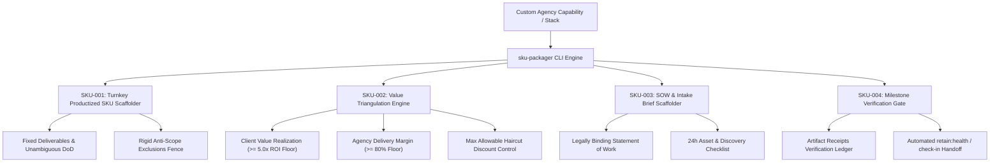

# sku — Productized Agency SKU Packager & Value Triangulation Engine

> **Operating Role**: Crew (Operations Lead & Client Delivery Specialist) & Jasper (Creative Technologist & Growth Mastermind)  
> **Direct Triggers**: "productized sku", "sku packager", "turnkey service", "fixed-scope packaging", "value pricing triangulation", "sow generator", "client intake brief", "milestone sign-off", "package agency services"  
> **Core Directives**: SKU-001 through SKU-004  

The `sku` mode productizes custom agency workflows into fixed-scope, turnkey client offerings. It eliminates custom proposal fatigue and scope creep by packaging engineering, marketing, design, and AI automation capabilities into predictable, high-margin SKUs backed by mathematical value triangulation, automated SOW contracts, and milestone verification gates.

---

## The 4 Core Invariants (SKU-001 – SKU-004)



---

### SKU-001: Turnkey Productized SKU Scaffolder

Custom consulting proposals waste weeks in scope ambiguity and margin leakage. SKU-001 structures all capabilities into standardized catalog units:

1. **Fixed-Scope Deliverable Spine**:
   - Deliverables are articulated as concrete, verifiable artifacts (e.g., "Full-stack Next.js app with strict TypeScript", "CI/CD release gate script"), never open-ended consulting hours.
2. **Deterministic Definition of Done (DoD)**:
   - Every SKU enforces objective DoD criteria: clean git branch with passing CI, zero Vibeguard credential leaks, 1-click local reproduction instructions, and verified walkthrough receipts.
3. **Rigid Anti-Scope Exclusions Fence**:
   - Every SKU explicitly lists excluded items (e.g. out-of-scope custom integrations, 24/7 dedicated support, client-side hosting costs). Any change requires an executed Change Order.

---

### SKU-002: Outcome-Based Value Triangulation Engine

Avoid the hourly trap. The value triangulation engine anchors pricing between the client's quantifiable upside and the agency's delivery cost floor:

$$\text{Value Ceiling} = \frac{\text{Client Annual Upside}}{\text{Target ROI Multiple}} \quad (\text{Target ROI} \ge 5.0\times)$$

$$\text{Cost Floor} = \frac{\text{Agency Direct Cost}}{1 - \text{Target Gross Margin}} \quad (\text{Target Margin} \ge 80\%)$$

$$\text{Recommended Price} = \max\left(\text{Cost Floor}, \; 0.85 \times \text{Value Ceiling}\right)$$

1. **Value Anchor (5.0x ROI Floor)**:
   - For an enterprise client realizing $100,000/yr in operational savings or revenue lift, a 5.0x ROI ceiling justifies a price up to $20,000.
2. **Gross Margin Ceiling ($\ge 80\%$)**:
   - Subagent automation and modular skill DOX architecture allow delivery direct costs (compute, tokens, senior review) to remain under 20% of revenue.
3. **Haircut Discount Discipline**:
   - Hard agency guardrail: Haircut discounts can never drop projected gross margin below **70.0%**. Any discount breaching the floor triggers an automated `REVISE` block.

---

### SKU-003: Automated SOW & Client Intake Brief Generator

Turn sales closes into executed legal agreements and structured intake in under 5 minutes:

1. **Statement of Work (SOW)**:
   - Auto-generates a standardized markdown SOW linking directly to the SKU's deliverables, DoD criteria, milestone schedule, and 50/50 payment milestones.
   - Embeds a 30-day post-delivery bug warranty under agreed retainer SLA terms.
2. **24-Hour Client Intake Brief**:
   - Auto-generates the onboarding questionnaire and required asset checklist (brand assets, domain DNS, API sandbox credentials provisioned into `.agents/context/vault/`).

---

### SKU-004: Milestone Verification Checklist & Sign-Off Packet

Delivery is not complete until verified by receipts:

1. **Delivery Receipts Ledger**:
   - Maps each deliverable to an immutable artifact URI, verification timestamp, and reviewing Council Lead (Nexus or Sol).
2. **Automated Retention Loop Handoff**:
   - Upon milestone sign-off, automatically triggers `retain:check-in` at delivery+7d and schedules the 30-day value note in `retain:health`.

---

## 🛠️ CLI Usage & Practical Workflows

```bash
# 1. Scaffold a new productized SKU in the operations catalog
bun skills/agency-delivery/ops/scripts/sku-packager.ts \
  --scaffold-sku \
  --name "AI Lead Engine" \
  --category "ai-automation" \
  --tier "growth" \
  --turnaround 7 \
  --price 7500

# 2. Triangulate value-based pricing from client ROI and agency direct cost
bun skills/agency-delivery/ops/scripts/sku-packager.ts \
  --calc-pricing \
  --value 120000 \
  --cost 2000

# 3. Generate a client-ready SOW and intake questionnaire
bun skills/agency-delivery/ops/scripts/sku-packager.ts \
  --generate-sow \
  --name "Aria Visual Builder" \
  --client "Vanguard Media"

# 4. Verify deliverable receipts for milestone sign-off
bun skills/agency-delivery/ops/scripts/sku-packager.ts \
  --verify-milestone \
  --sku sku.json \
  --receipts receipts.json
```

---

## 📊 Quality Verification Checklist

Before publishing or pitching any agency SKU:
- [ ] Deliverables structured with objective Definition of Done and anti-scope boundaries (SKU-001).
- [ ] Pricing model satisfies $\ge 5.0\times$ client ROI and $\ge 80\%$ agency gross margin floor (SKU-002).
- [ ] Complete Statement of Work and 24h intake checklist generated (SKU-003).
- [ ] Milestone delivery receipts mapped and verified before client sign-off (SKU-004).
