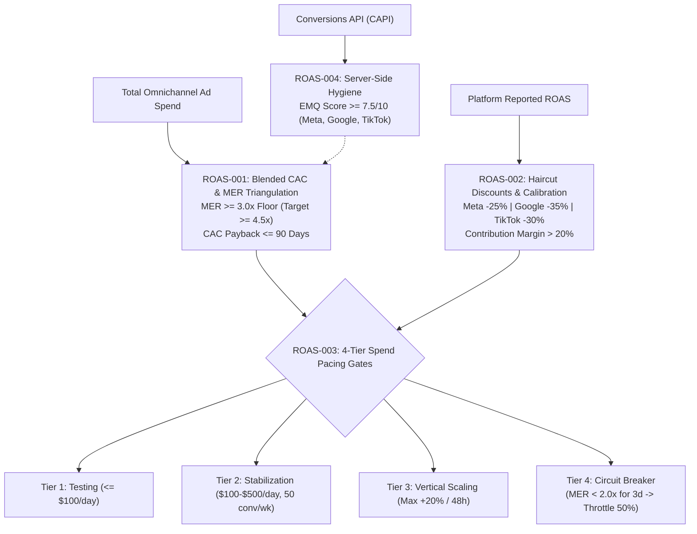

# roas — Omnichannel ROAS Attribution, Blended CAC & Ad Spend Pacing Engine

> **Operating Role**: Crew (Agency Council Operations Lead & Client Delivery Specialist)  
> **Direct Triggers**: "roas", "blended cac", "mer", "marketing efficiency ratio", "ad attribution", "ad spend audit", "channel roas", "post-ios14 attribution", "ad profitability", "ad budget pacing"  
> **Core Directives**: ROAS-001 through ROAS-004  

The `roas` mode provides omnichannel Marketing Efficiency Ratio (MER) triangulation, blended Customer Acquisition Cost (CAC) calibration, in-platform ROAS haircut discounting, 4-tier spend pacing gates, and post-iOS 14 server-side tracking (CAPI) hygiene. It guarantees client ad profitability without relying on inflated platform self-attribution.

---

## The 4 Core Invariants (ROAS-001 – ROAS-004)



### ROAS-001: Omnichannel Blended CAC & Marketing Efficiency Ratio (MER) Triangulation
Never judge advertising effectiveness solely through siloed, platform-reported ROAS. Every account must triangulate performance against top-line financial reality:

$$\text{MER} = \frac{\text{Total Topline Revenue}}{\text{Total Omnichannel Ad Spend}}$$

$$\text{Blended CAC} = \frac{\text{Total Omnichannel Ad Spend}}{\text{Total New Customers Acquired}}$$

1. **MER Floor & Targets**:
   - **Absolute Hard Floor**: $\text{MER} \ge 3.0\times$. If 7-day rolling blended MER dips below $3.0\times$, scaling is prohibited and creative/offer revision is triggered.
   - **Target Performance**: $\text{MER} \ge 4.5\times$ for aggressive budget expansion.
   - **Extreme Danger**: $\text{MER} < 2.0\times$ immediately triggers the circuit breaker (ROAS-003).
2. **Blended CAC Payback Constraint**:
   - New customer acquisition cost must achieve payback within $\le 90\text{ days}$ based on historical 90-day Customer Lifetime Value (LTV).
   - If CAC exceeds the 90-day gross margin contribution per customer, ad spend must be retargeted toward higher-intent SKU baskets.

### ROAS-002: In-Platform ROAS Haircut Discounts & Multi-Touch Attribution Calibration
Ad platforms exploit self-attribution and view-through conversions to claim overlapping credit for the same orders. In-platform metrics must be discounted with mandatory haircuts before evaluating channel profitability:

| Platform / Campaign Type | Mandatory Haircut | Attribution Inflation Mechanism | Discounted ROAS Formula |
|:---|:---|:---|:---|
| **Meta Advantage+** | **25% discount** | View-through conversions, cross-device leakage, remarketing cannibalization | $\text{Real ROAS} = \text{Reported ROAS} \times 0.75$ |
| **Google PMax / Brand Search** | **35% discount** | Organic brand query hijacking, non-incremental existing customer clicks | $\text{Real ROAS} = \text{Reported ROAS} \times 0.65$ |
| **TikTok Ads** | **30% discount** | High view-through claim window, low post-click purchase follow-through | $\text{Real ROAS} = \text{Reported ROAS} \times 0.70$ |
| **Secondary Platforms** | **20% discount** | Fractional credit attribution leakage | $\text{Real ROAS} = \text{Reported ROAS} \times 0.80$ |

- **Contribution Margin After Ad Spend Invariant**:
  $$\text{Contribution Margin} = \frac{\text{Total Revenue} - \text{Total Ad Spend}}{\text{Total Revenue}} > 20\%$$
  Any spend plan or channel mix that drives contribution margin below $20\%$ after paid media is deemed structurally unprofitable and rejected.

### ROAS-003: 4-Tier Ad Spend Pacing & Scaling Gates
Ad spend allocation must progress through strict deterministic gates to prevent algorithmic reset, auction overheating, and budget burnout:

```
Tier 1: Testing & Sandbox      Tier 2: Stabilization         Tier 3: Vertical Scaling       Tier 4: Circuit Breaker
[ Spend <= $100/day ]   -->    [ $100-$500/day ]      -->    [ Max +20% / 48 hours ]  -->   [ MER < 2.0x for 3 days ]
Creative & Hook Validation     50 conv/week milestone        MER >= Target & Steady CPA     Throttle Spend 50%
```

1. **Tier 1 (Testing & Validation)**: Daily budget $\le \$100/\text{day}$ per campaign. Purpose is creative hook testing, CTR/CPC baseline discovery, and initial conversion event firing.
2. **Tier 2 (Stabilization & Learning Exit)**: Daily budget $\$100 - \$500/\text{day}$. Minimum volume threshold: $\ge 50\text{ conversion events/week}$ per ad set to exit the algorithmic learning phase.
3. **Tier 3 (Vertical Scaling)**: Maximum budget increase of $+20\%\text{ per } 48\text{ hours}$. Exceeding $20\%$ in 48 hours resets the bid model and triggers rapid CPA spikes.
4. **Tier 4 (Circuit Breaker Guardrail)**: If 3-day rolling blended MER falls below $2.0\times$ OR blended CAC exceeds $1.5\times$ the target threshold, **throttle spend by 50% immediately** across bottom-performing ad sets.

### ROAS-004: Post-iOS 14 Server-Side Tracking & First-Party Data Hygiene (CAPI)
Client-side browser pixels alone lose $30\% - 50\%$ of conversion signals due to Safari ITP, Firefox tracking protection, and ad blockers. Server-side tracking is non-negotiable:

1. **Mandatory Server-Side Tri-Stack**:
   - Meta Conversions API (CAPI) via direct server gateway or Google Tag Manager Server-Side.
   - Google Ads Enhanced Conversions with SHA-256 hashed customer parameters (`email`, `phone_number`).
   - TikTok Events API with server-to-server payload delivery.
2. **Event Match Quality (EMQ) Standard**:
   - Event Match Quality score must consistently achieve $\ge 7.5 / 10$ on Meta Events Manager.
   - Every server-side event must supply hashed first-party identifiers (`em`, `ph`, `client_ip_address`, `client_user_agent`, `fbp`, `fbc`).
   - Deduplication parameters (`event_id` and `event_name`) must match identically between browser pixel and server payload.

---

## Omnichannel ROAS & Attribution Metrics Rubric

| Metric | Target (Elite) | Acceptable | Failing (Redesign) | Remedy |
|:---|:---|:---|:---|:---|
| **Blended MER** | $\ge 4.5\times$ | $3.0\times - 4.4\times$ | $< 3.0\times$ | Audit creative fatigue, eliminate zero-ROAS ad sets, adjust target CPA |
| **Blended CAC Payback** | $\le 30\text{ days}$ | $31 - 90\text{ days}$ | $> 90\text{ days}$ | Shift spend to high AOV bundles; optimize retention and re-order sequences |
| **Contribution Margin** | $\ge 40\%$ | $20\% - 39\%$ | $< 20\%$ | Cap ad spend burn; apply steeper haircut discounts; review product margins |
| **Scaling Pace** | $\le 15\% / 48\text{h}$ | $15\% - 20\% / 48\text{h}$ | $> 20\% / 48\text{h}$ | Enforce Tier 3 pacing throttle; split into horizontal campaign scaling |
| **Event Match Quality (EMQ)**| $\ge 8.5 / 10$ | $7.5 - 8.4 / 10$ | $< 7.5 / 10$ | Pass additional hashed customer parameters (phone, zip, city, fbc/fbp) |
| **Circuit Breaker Status** | Normal (Full) | Watch (Daily check) | Tripped (Throttle 50%) | Cut bottom 50% spend immediately; triage landing page and checkout |

---

## Pacing Schedule Markdown Schema

```markdown
### Omnichannel Ad Budget Pacing & ROAS Scaling Schedule

| Channel / Initiative | Monthly Budget | Daily Baseline | Haircut Applied | Discounted ROAS Target | Scaling Tier |
|:---|:---|:---|:---|:---|:---|
| **Meta Ads (Advantage+)** | $12,000 | $395 / day | 25% | 3.2x (Reported: 4.3x) | Tier 2 (Stabilization) |
| **Google Ads (PMax & Search)**| $9,000 | $296 / day | 35% | 3.0x (Reported: 4.6x) | Tier 2 (Stabilization) |
| **TikTok Ads (Spark)** | $3,000 | $99 / day | 30% | 2.5x (Reported: 3.6x) | Tier 1 (Testing) |
| **Contingency Reserve** | $3,000 | On Trigger | N/A | Target MER >= 4.5x | Dynamic Allocation |

*All channels require verified CAPI event matching >= 7.5/10 and enforce max 20% budget increases per 48 hours.*
```

---

## Automated Inspection & Execution via `roas-calculator.ts` CLI

Run Crew's ROAS attribution and pacing calculator CLI:

```bash
# 1. Calculate Marketing Efficiency Ratio (MER) and Blended CAC
bun skills/agency-delivery/paidads/scripts/roas-calculator.ts --calc-mer --revenue 45000 --spend 10000 --customers 250 --json

# 2. Triangulate multi-channel ROAS with platform haircut discounts
bun skills/agency-delivery/paidads/scripts/roas-calculator.ts --triangulate-roas --meta-spend 5000 --meta-roas 3.8 --google-spend 3500 --google-roas 4.2 --tiktok-spend 1500 --tiktok-roas 2.9 --total-rev 42000 --json

# 3. Audit ad spend configuration file against ROAS-001 through ROAS-004
bun skills/agency-delivery/paidads/scripts/roas-calculator.ts --audit-spend ad-spend-config.json --json

# 4. Scaffold budget pacing schedule with 4-tier scaling gates
bun skills/agency-delivery/paidads/scripts/roas-calculator.ts --scaffold-pacing --budget 25000 --target-mer 4.5 --output .agents/artifacts/ad-pacing-schedule.md
```

---

## Verification & Acceptance Checklist

- [ ] Blended MER is calculated from total top-line revenue divided by total ad spend.
- [ ] Absolute MER floor ($\ge 3.0\times$) and target ($\ge 4.5\times$) are enforced.
- [ ] Blended CAC payback period is certified $\le 90\text{ days}$.
- [ ] In-platform haircut discounts applied: Meta $25\%$, Google $35\%$, TikTok $30\%$.
- [ ] Net contribution margin after total ad spend is certified $> 20\%$.
- [ ] Pacing rules enforce max $+20\%$ budget expansion per $48\text{ hours}$.
- [ ] Circuit breaker safety mechanism configured (50% throttle on MER $< 2.0\times$ for 3 days).
- [ ] Server-side Conversions API (CAPI) active with Event Match Quality $\ge 7.5/10$.
