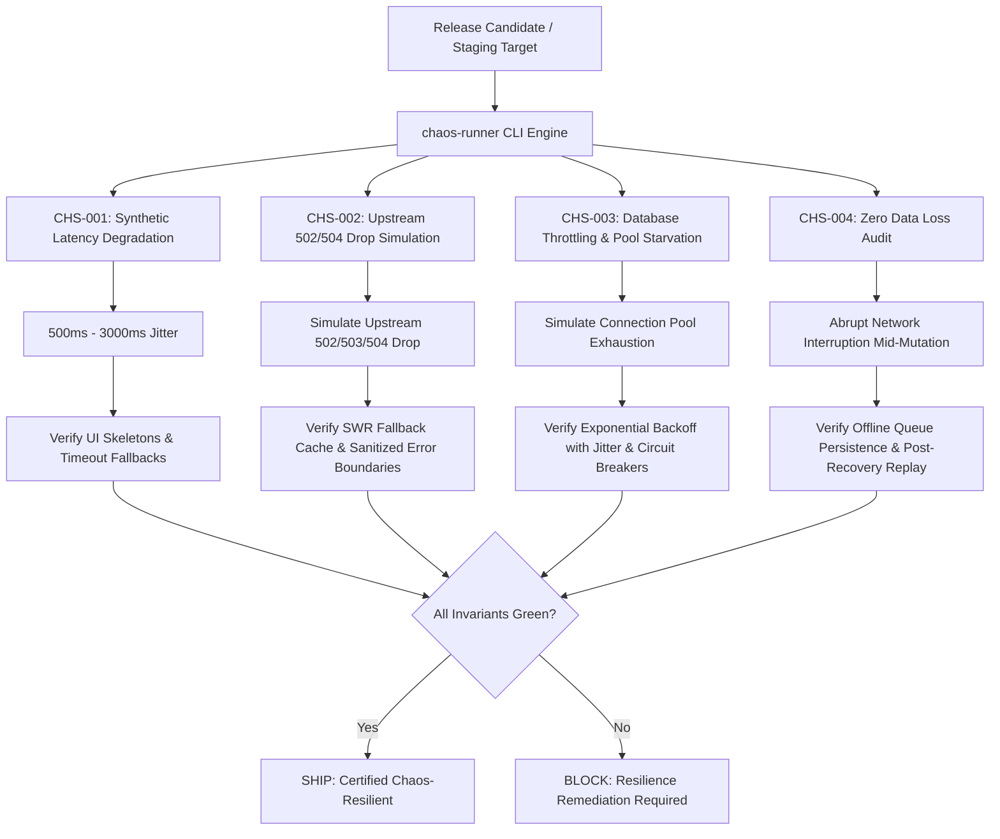

# chaos — Synthetic Fault Injection & System Resilience Testing

> **Operating Role**: Nexus (Technical Director & Review Head — The Quality Gate)  
> **Direct Triggers**: "chaos test", "fault injection", "resilience testing", "latency jitter", "upstream blackout", "service drop", "database throttling", "connection exhaustion", "zero data loss audit"  
> **Core Directives**: CHS-001 through CHS-004  
> **Primary Tooling**: `skills/agency-delivery/qa-launch/scripts/chaos-runner.ts`

The `chaos` mode enforces Nexus's mandatory resilience verification before any release goes live. Production systems never fail cleanly in isolation—they suffer network latency jitter, partial upstream drops, connection pool exhaustion, and abrupt client disconnects. The `chaos-runner` actively injects synthetic failure states into mock and staging infrastructure to certify graceful degradation and mathematically prove zero data loss.

---

## The 4 Core Invariants (CHS-001 – CHS-004)



---

### CHS-001: Synthetic Latency Degradation
- **Failure Mode**: High network latency causes UI freezes, broken spinners, race conditions, and unhandled client timeouts.
- **Fault Injection**: Injects random synthetic jitter between 500ms and 3000ms on simulated endpoint responses.
- **Verification Gate**:
  - UI must immediately mount accessible skeleton placeholders or loading indicators within 150ms.
  - Client must trip deterministic timeout boundaries at configured SLA ceilings (e.g. 2500ms) without blank screens.
  - User input controls must remain interactive or display graceful retry actions.

### CHS-002: Upstream 502/504 Drop Simulation
- **Failure Mode**: Critical third-party APIs (payment processors, authentication providers, recommendation engines) experience total or intermittent blackouts.
- **Fault Injection**: Intercepts requests and drops them with HTTP 502 Bad Gateway, 503 Service Unavailable, or 504 Gateway Timeout responses.
- **Verification Gate**:
  - Stale-while-revalidate (SWR) cache must engage to serve the last-known-good cached state where appropriate.
  - User-facing error boundaries must render sanitized, actionable messaging—never leaking internal stack traces, credentials, or raw JSON payloads to clients.
  - Degradation must be localized (e.g., failure of an ad widget must never block product checkout).

### CHS-003: Database Throttling & Connection Exhaustion
- **Failure Mode**: Traffic spikes or slow queries exhaust the database connection pool, leading to cascading service death.
- **Fault Injection**: Artificially constrains pool capacity to 10 connections and floods the service with concurrent read/write requests.
- **Verification Gate**:
  - Requests exceeding capacity must be buffered in bounded retry queues rather than dropped immediately.
  - Retries must execute with jittered exponential backoff ($T_{\text{wait}} = 2^{\text{retry}} \times \text{base} + \text{jitter}$) to prevent thundering herd spikes.
  - Circuit breakers must trip cleanly when error rates exceed 50% over a 10s sliding window, protecting database viability.

### CHS-004: Zero Data Loss Audit
- **Failure Mode**: Sudden network loss during checkout, form submission, or background drafting results in lost customer work or dropped transactions.
- **Fault Injection**: Abruptly severs network connectivity in the middle of a continuous stream of mutations.
- **Verification Gate**:
  - Uncommitted mutations must be buffered into durable browser storage (IndexedDB / LocalStorage) or local append-only logs.
  - Post-recovery reconnection must trigger an automatic reconciliation pass, replaying buffered events in exact sequence order.
  - Final state verification confirms 100% of mutations are either committed or cleanly flagged for user confirmation—zero dropped mutations and zero silent corruption.

---

## Execution Workflow

1. **Target Configuration**: Define endpoints, pool limits, and mutation vectors to test.
2. **Execute Fault Battery (`chaos-runner.ts`)**: Run the automated simulation:
   ```bash
   bun skills/agency-delivery/qa-launch/scripts/chaos-runner.ts
   ```
3. **Audit Results**: Verify all 4 invariants pass. If any invariant fails, extract the failure traces and route to `webdev` (for frontend error boundaries / caching) or `devops` (for circuit breaker & connection pool tuning).
4. **Final Gate**: Block release candidate until the chaos resilience report achieves 100% passing status.
