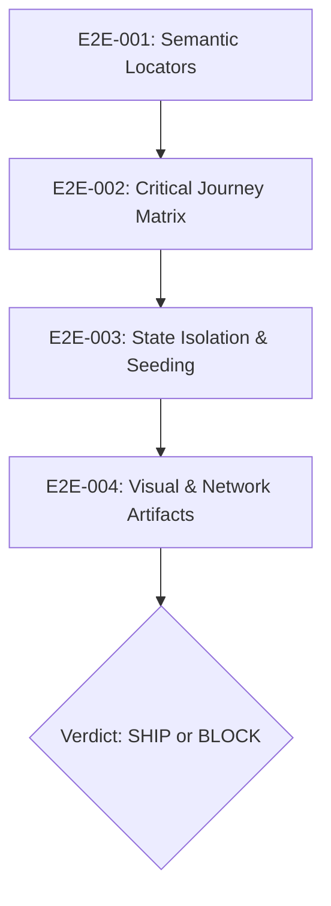

# e2e — Synthetic User Journey & Headless Playwright Smoke Suite

> **Operating Role**: Jasper & Nexus (Agency Council QA & Quality Gate)  
> **Direct Triggers**: "e2e tests", "playwright smoke suite", "synthetic user journey", "headless checkout test", "auth smoke test", "e2e runner", "audit test locators"  
> **Core Directives**: E2E-001 through E2E-004  

The `e2e` mode delivers headless Playwright end-to-end smoke testing, synthetic customer journey validation, and test architecture auditing. It verifies critical-path business flows (registration, authentication, cart mutations, checkout, onboarding) using robust, accessible locators and deterministic state seeding without flaky sleeps or brittle CSS selectors.

---

## The 4 Core Invariants (E2E-001 – E2E-004)



### E2E-001: Semantic & Accessible Locators First
- **Web-First & Accessible Selection**: Locate elements the way assistive technology and human users interact with the page:
  1. `page.getByRole('button', { name: /checkout/i })`
  2. `page.getByLabel('Work Email')`
  3. `page.getByText('Order Confirmation')`
  4. `page.getByPlaceholder('e.g. Acme Corp')`
  5. Fallback: `page.getByTestId('cart-drawer-toggle')` with explicit `data-testid` attributes.
- **Banned Selector Anti-Patterns**:
  - Prohibit arbitrary CSS hierarchy paths: `div.container > section:nth-child(2) > div > button`.
  - Prohibit Tailwind or styling classes: `button.bg-blue-600.hover\\:bg-blue-700.px-4`.
  - Prohibit brittle XPath expressions: `xpath=//div[3]/span/input`.
- **Zero Arbitrary Sleeps**: `page.waitForTimeout()` is strictly prohibited in all test files. All assertions must use Playwright auto-waiting assertions (`await expect(page.getByRole('alert')).toBeVisible({ timeout: 5000 })`).

### E2E-002: Critical Journey Smoke Matrix
Every release candidate must pass headless smoke validation across the 5 core customer journeys:
1. **Guest-to-Auth Journey**: Landing page visit $\to$ signup form submission $\to$ email confirmation / magic link redemption $\to$ authenticated session landed.
2. **Shopping-to-Checkout Journey**: Product selection $\to$ cart quantity update $\to$ promo code application $\to$ address input $\to$ mock Stripe/payment completion $\to$ order confirmation page rendered with order ID.
3. **User Onboarding Funnel**: Post-auth team workspace naming $\to$ invite member step (or skip) $\to$ primary dashboard empty state resolution.
4. **Self-Serve Password Reset & MFA**: Forgotten password initiation $\to$ reset token verification $\to$ credential replacement $\to$ re-auth challenge.
5. **Account Deletion & Data Privacy Compliance**: Settings navigation $\to$ verification modal prompt $\to$ account closure execution $\to$ session invalidation & redirect to goodbye screen.

Execution Budget: The entire critical smoke suite must execute in under 60 seconds in headless Chromium CI.

### E2E-003: State Isolation & Ephemeral Seeding
- **Zero Cross-Test Leakage**: Every test spec must run in complete isolation. Tests must never assume database state created by a preceding test.
- **Storage State Re-use**: For non-auth journeys (e.g. checkout, settings), bypass repetitive UI login forms by injecting pre-authenticated browser state fixtures (`test.use({ storageState: 'playwright/.auth/customer.json' })`) or executing API login calls (`request.post('/api/auth/login')`).
- **Dynamic Entity Scoping**: All seeded test entities (users, teams, orders) must carry unique ephemeral run tokens (e.g. `test-${Date.now()}-${randomUUID().slice(0, 8)}@example.com`).
- **Deterministic Teardown**: Provide teardown hooks (`afterEach` / API deletion endpoints) or ephemeral container databases to prevent persistent data pollution.

### E2E-004: Visual & Network Artifacts
- **Trace on First Retry**: Configure `trace: 'on-first-retry'` in `playwright.config.ts` to capture execution DOM snapshots, actions, and network timings upon failure.
- **Screenshots on Assertion Failure**: Capture full-page viewport screenshots automatically when any critical step fails (`screenshot: 'only-on-failure'`).
- **Network & Console Error Guard**:
  - Fail test immediately if unhandled browser console errors (`console.error`) fire during navigation.
  - Monitor network traffic: flag unexpected 4xx/5xx API responses triggered during user journeys:
    ```typescript
    page.on('response', (response) => {
      if (response.status() >= 500) {
        throw new Error(`5xx API Failure detected on ${response.url()}: ${response.status()}`);
      }
    });
    ```

---

## Playwright Smoke Scaffold Blueprint

```typescript
import { test, expect } from '@playwright/test';

test.describe('Critical Journey: Guest-to-Checkout Flow', () => {
  test.beforeEach(async ({ page }) => {
    // Fail fast on unhandled console errors or internal server failures
    page.on('console', (msg) => {
      if (msg.type() === 'error') {
        console.error(`Browser console error: ${msg.text()}`);
      }
    });
  });

  test('completes guest cart add, promo code, and checkout confirmation', async ({ page }) => {
    // 1. Visit catalog
    await page.goto('/pricing');
    await expect(page).toHaveTitle(/Pricing/i);

    // 2. Select plan with semantic role
    const tierButton = page.getByRole('button', { name: /choose pro plan/i });
    await expect(tierButton).toBeVisible();
    await tierButton.click();

    // 3. Complete checkout modal
    const emailInput = page.getByLabel(/work email/i);
    await emailInput.fill(`tester-${Date.now()}@example.com`);

    const checkoutSubmit = page.getByRole('button', { name: /confirm order/i });
    await checkoutSubmit.click();

    // 4. Assert order confirmation state
    await expect(page.getByRole('heading', { name: /thank you for your order/i })).toBeVisible({ timeout: 8000 });
    await expect(page.getByTestId('order-receipt-id')).not.toBeEmpty();
  });
});
```

---

## Verification & Block-or-Ship Verdict

| Finding Severity | Defect Characteristic | Action Required |
|:---|:---|:---|
| **CRITICAL (Block Ship)** | Any failure in 5 core journeys; unhandled 500 error; hardcoded credentials in test specs; tests using `waitForTimeout`. | **BLOCK RELEASE**. Route to owning engineer (`webdev`/`accounts`). |
| **WARNING (Triage)** | Test runtime > 30s for a single journey; brittle CSS selectors detected; missing error screenshot configuration. | Flag in QA Report; refactor before next milestone. |
| **PASS (Ship Cleared)** | 5 core journeys passing headless in < 60s; semantic role locators verified; zero console error traps. | **SHIP CLEARED**. Emit QA Sign-Off receipt. |
