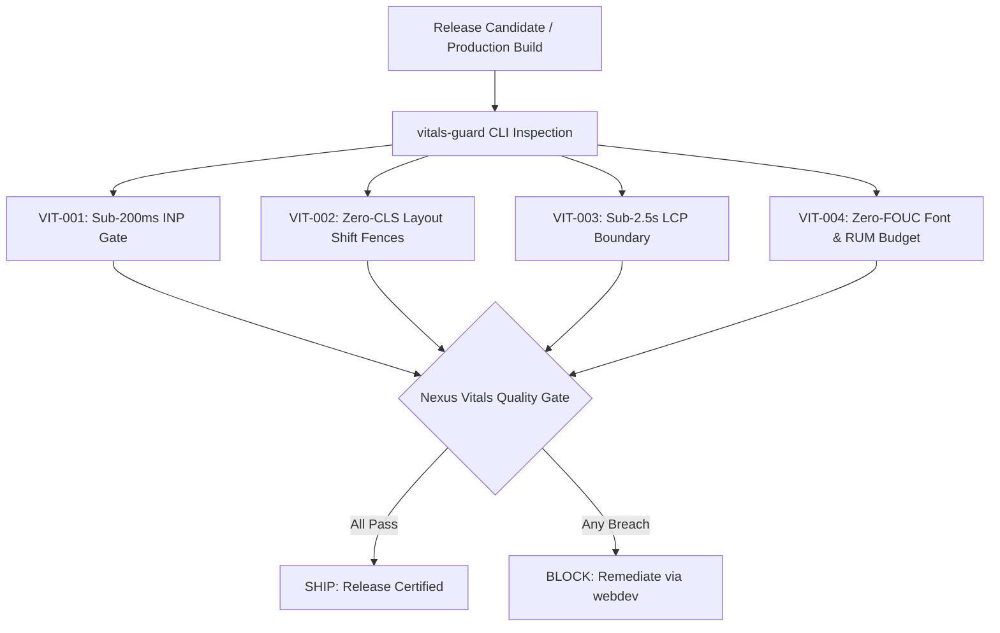

# vitals — Core Web Vitals Auditor & Performance Gate

> **Operating Role**: Nexus (Technical Director & Review Head — The Quality Gate)  
> **Direct Triggers**: "core web vitals", "inp audit", "cls layout shift", "lcp optimization", "web font founc", "vitals guard", "rum budget", "sub-200ms inp", "vitals check"  
> **Core Directives**: VIT-001 through VIT-004  

The `vitals` mode enforces Nexus's uncompromising Core Web Vitals quality gate across Interaction to Next Paint (INP), Cumulative Layout Shift (CLS), Largest Contentful Paint (LCP), and Web Font FOUC/FOIT budget certification. It audits source markup, CSS rules, JavaScript handlers, and production builds, issuing a strict **Pass** or **Block** verdict before any release candidate is cleared for launch.

---

## The 4 Core Invariants (VIT-001 – VIT-004)



### VIT-001: Sub-200ms INP Gate & Long Task Elimination
Interaction to Next Paint (INP) replaces FID as Google's official responsiveness metric. Nexus mandates that the 75th percentile of user interactions across all devices and network tiers must execute under **200ms** (target: $\le 150\text{ms}$).

1. **Main-Thread Long Task Elimination**:
   - Any JavaScript task exceeding **50ms** blocks user input and is classified as a Long Task.
   - Long computational loops, large JSON parsing, and DOM batch operations must be split across frames using `scheduler.yield()` (with `setTimeout(..., 0)` or `requestIdleCallback` fallback).
   - Event listeners for high-frequency events (`scroll`, `resize`, `mousemove`, `touchmove`) must use `{ passive: true }` and be throttled or debounced via `requestAnimationFrame`.
2. **Synchronous UI Blocking Ban**:
   - Never run blocking operations inside `onClick`, `onInput`, or `onSubmit` handlers.
   - Immediate visual feedback (state change, loading indicator, optimistic update) must paint in frame 1 ($\le 16\text{ms}$), while asynchronous network mutations process in the background.

### VIT-002: Zero-CLS Layout Shift & Aspect-Ratio Fences
Cumulative Layout Shift (CLS) measures visual stability. Nexus mandates a production CLS ceiling of **$\le 0.1$** at p75, with an agency target of **$\le 0.05$**.

1. **Strict Dimensional Fences for Media**:
   - Every ``, `<video>`, `<iframe>`, and SVG embed must declare explicit `width` and `height` attributes or CSS `aspect-ratio` rules.
   - Browsers compute the layout aspect ratio before downloading the asset, preventing layout shifting when the image resolves.
2. **Dynamic Slot & Ad Container Reservation**:
   - Dynamic banner slots, third-party embeds, cookie consent notices, and chat widgets must have pre-reserved container heights or `min-height` CSS definitions.
   - Dynamic user-prompted content must never be injected above existing content unless triggered directly by explicit user action (e.g. accordion click).
3. **Skeleton Placeholders**:
   - Client-side fetched cards and data tables must render with structured CSS skeletons matching exact card dimensions to eliminate content jump on resolution.

### VIT-003: Sub-2.5s LCP Boundary & Critical Resource Prioritization
Largest Contentful Paint (LCP) measures perceived loading speed. Nexus mandates an LCP ceiling of **$\le 2.5\text{s}$** at p75 under throttled 4G mobile conditions.

1. **Critical Hero Asset Prioritization**:
   - The primary above-the-fold hero image or video poster must declare `fetchpriority="high"` and `loading="eager"`.
   - **Lazy Loading Ban on Hero Assets**: Never attach `loading="lazy"` or `decoding="async"` to the LCP element. Doing so delays discovery and triggers an immediate Nexus gate block.
2. **Preconnect & Preload Directives**:
   - Critical font origins and external media CDN domains must be declared in `<head>` with `<link rel="preconnect" href="...">`.
   - Critical hero images or primary web fonts should be declared with `<link rel="preload" as="image" ...>` or `<link rel="preload" as="font" type="font/woff2" crossorigin>`.
3. **Zero Render-Blocking Non-Critical Assets**:
   - Non-critical scripts must carry `defer`, `async`, or `type="module"`.
   - Eliminate CSS `@import` cascades in external stylesheets; compile into a single critical CSS bundle or inline above-the-fold critical CSS.

### VIT-004: Web Font FOUC/FOIT Elimination & Real User Monitoring (RUM) Budget
Web fonts cause Flash of Unstyled Text (FOUC) or Flash of Invisible Text (FOIT) if not strictly controlled.

1. **Font Loading Strategy**:
   - Every `@font-face` declaration must enforce `font-display: swap` (immediate text display with fallback) or `font-display: optional` (instant render with fallback if font is not cached).
   - Pair fallback system fonts with CSS `@font-face` size-adjust descriptors (`size-adjust`, `ascent-override`, `descent-override`) to match glyph dimensions and eliminate layout shift when web fonts swap.
2. **Font Payload Budget**:
   - Modern WOFF2 format exclusively. Deprecate TTF, OTF, EOT, and SVG font formats.
   - Subset fonts to the exact unicode range required (e.g., Latin basic: `U+0000-00FF`).
   - Font payload ceiling: maximum **100KB** total across all font files loaded on first page paint.
3. **Automated Vitals Guard Verification**:
   - Run `bun skills/agency-delivery/qa-launch/scripts/vitals-guard.ts --audit-vitals <target>` to verify all HTML, CSS, and TS/JS assets before release sign-off.

---

## Vitals Threshold & Gate Verdict Matrix

| Metric | Target (Good) | Needs Improvement | Block Threshold (Fail) | Inspection Method |
|:---|:---|:---|:---|:---|
| **INP** (Interaction to Next Paint) | $\le 150\text{ms}$ | $151 - 200\text{ms}$ | $> 200\text{ms}$ | Chrome Performance / RUM / `vitals-guard --check-inp` |
| **CLS** (Cumulative Layout Shift) | $\le 0.05$ | $0.051 - 0.10$ | $> 0.10$ | DevTools Layout Shifts / `vitals-guard --check-cls` |
| **LCP** (Largest Contentful Paint) | $\le 2.0\text{s}$ | $2.1 - 2.5\text{s}$ | $> 2.5\text{s}$ | WebPageTest / Lighthouse / `vitals-guard --check-lcp` |
| **FCP** (First Contentful Paint) | $\le 1.2\text{s}$ | $1.3 - 1.8\text{s}$ | $> 1.8\text{s}$ | WebPageTest / Lighthouse |
| **TTFB** (Time to First Byte) | $\le 400\text{ms}$ | $401 - 800\text{ms}$ | $> 800\text{ms}$ | Edge CDN Cache HIT verification |
| **Font Budget** | $\le 75\text{KB}$ | $76 - 100\text{KB}$ | $> 100\text{KB}$ | `vitals-guard --check-fonts` |

---

## Automated Inspection via `vitals-guard.ts` CLI

Run Nexus's static Core Web Vitals auditor directly from the terminal:

```bash
# Full vitals audit across workspace or build directory
bun skills/agency-delivery/qa-launch/scripts/vitals-guard.ts --audit-vitals dist/ --json

# Targeted CLS layout shift scan (missing width/height or aspect-ratio)
bun skills/agency-delivery/qa-launch/scripts/vitals-guard.ts --check-cls src/

# Targeted INP long-task & unthrottled event listener scan
bun skills/agency-delivery/qa-launch/scripts/vitals-guard.ts --check-inp src/

# Targeted LCP hero element and lazy-loading anti-pattern scan
bun skills/agency-delivery/qa-launch/scripts/vitals-guard.ts --check-lcp src/

# Web font format & FOUC/FOIT declaration audit
bun skills/agency-delivery/qa-launch/scripts/vitals-guard.ts --check-fonts src/styles/
```
