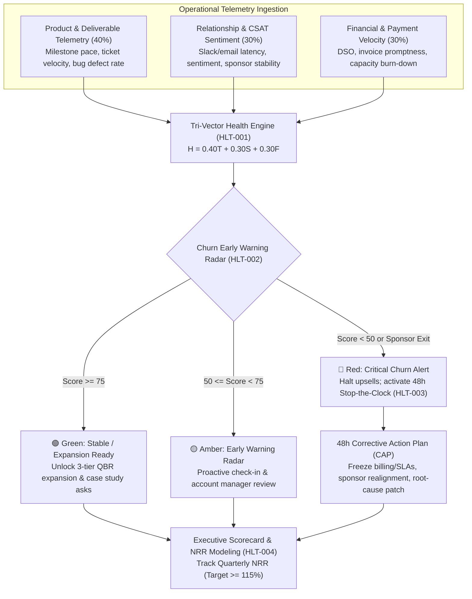

# health — Client Account Health Telemetry, Churn Radar & Intervention Governance

> **Operating Principle**: Client churn is never sudden; it is the lagging result of unmonitored operational decay. Waiting for a cancellation notice or non-renewal email is organizational malpractice. Account retention requires active triangulation across product telemetry, stakeholder sentiment, and financial velocity—enforcing automated early warning thresholds and 48-hour stop-the-clock interventions before relationships break.

---

## The Tri-Vector Account Health Architecture



---

## 🔒 The 4 Core Retention Health Invariants

Every retained account managed under this skill must satisfy four operational invariants:

### 1. Tri-Vector Health Scoring Formula (HLT-001)
Client health cannot be assessed solely by qualitative impressions or billing regularity. The composite health score ($H \in [0, 100]$) is mathematically triangulated across three distinct operational vectors:

$$H = 0.40 \cdot T_{\text{product}} + 0.30 \cdot S_{\text{sentiment}} + 0.30 \cdot F_{\text{financial}}$$

1. **Product & Deliverable Telemetry ($T_{\text{product}}$, 40% weight)**:
   - On-time milestone completion rate.
   - P0/P1 unresolved defect count.
   - Ticket turnaround time vs agreed SLA.
   - Uptime/build verification logs.
2. **Relationship & CSAT Sentiment ($S_{\text{sentiment}}$, 30% weight)**:
   - Communication response latency (<4 hours = 100, >48 hours = 20).
   - Natural language interaction tone and friction keywords.
   - Executive sponsor stability (sudden sponsor departure drops vector by 35 points).
   - Stakeholder attendance in weekly syncs.
3. **Financial & Payment Velocity ($F_{\text{financial}}$, 30% weight)**:
   - Days Sales Outstanding (DSO) and invoice settlement promptness.
   - Retainer capacity burn-down alignment (avoiding sudden end-of-month surges).
   - Scope creep dispute frequency.

### 2. Churn Early Warning Radar (HLT-002)
The portfolio radar segments accounts into three actionable operational tiers:
- **🟢 Green Tier ($H \ge 75$)**: Account is thriving. Shipped deliverables produce measurable business ROI. Account is qualified for quarterly contract expansion (`retain:renewal`), delight-peak review asks (`retain:review-ask`), and co-marketing case studies (`content:case-study`).
- **🟡 Amber Tier ($50 \le H < 75$)**: Warning signals detected. Leading indicators show subtle friction (e.g. invoice delayed 7+ days, response latency slipping, or repeat bug triage). Triggers a mandatory internal review and informal relationship pulse check within 5 business days.
- **🔴 Red Tier ($H < 50$ or Key Sponsor Departure)**: Critical churn alert. Severe risk of contract termination. Freezes all upsell, referral, and renewal conversations immediately and triggers mandatory `HLT-003` intervention.

### 3. 48-Hour Stop-the-Clock Intervention Protocol (HLT-003)
When an account enters Red status or experiences an executive sponsor departure:
1. **Billing & SLA Freeze**: The agency immediately freezes the hourly billing clock and SLA response penalty counters for 48 hours.
2. **Executive Realignment**: Crew (Operations Lead) and Nexus (Technical Director) schedule a mandatory 30-minute alignment call with the client executive sponsor within 48 hours.
3. **Corrective Action Plan (CAP)**: Deliver a structured 4-phase remediation document (`INCIDENT_ROOT_CAUSE.md` and re-baselined milestone schedule) to restore stability.

### 4. Executive Health Scorecard & NRR Forecasting (HLT-004)
Portfolio performance is governed at the agency level through Quarterly Net Retention Rate (NRR) and Gross Retention Rate (GRR):

$$\text{NRR} = \frac{\text{Starting ARR} + \text{Expansion ARR} - \text{Contraction ARR} - \text{Churn ARR}}{\text{Starting ARR}} \times 100\%$$

- **Target Agency Benchmark**: $\text{NRR} \ge 115\%$ (demonstrates that expansion revenue from healthy accounts outpaces natural churn).
- Generates executive portfolio scorecards detailing total ARR distribution across Green/Amber/Red tiers, highlighting total at-risk capital.

---

## 📊 Account Health Audit Rubric

| Vector | Metric | Source of Truth | Green (High) | Amber (Mid) | Red (Critical) |
| :--- | :--- | :--- | :--- | :--- | :--- |
| **Product** (40%) | Milestone On-Time Rate | Linear / GitHub Milestones | $\ge 90\%$ on schedule | $70–89\%$ delayed | $< 70\%$ delayed |
| **Product** (40%) | Unresolved P0/P1 Bugs | Issue Tracker / Sentry | 0 critical defects | 1–2 open defects | $\ge 3$ open defects |
| **Product** (40%) | SLA Response Adherence | Retainer SLA Ledger | $\ge 95\%$ on time | $85–94\%$ on time | $< 85\%$ breached |
| **Sentiment** (30%) | Communication Latency | Slack / Email Telemetry | $< 4\text{ hours}$ | $4–24\text{ hours}$ | $> 48\text{ hours}$ (Silence) |
| **Sentiment** (30%) | Sponsor Stability | Stakeholder Records | Original champion in place | Champion transitioning | Key sponsor departed |
| **Financial** (30%) | Days Past Due (DPD) | Stripe / Invoicing | Paid on receipt ($< 3\text{d}$) | $4–14\text{ days overdue}$ | $> 14\text{ days overdue}$ |
| **Financial** (30%) | Scope Dispute Ratio | Billing Disputes | Zero billing disputes | Minor scope friction | Formal payment freeze |

---

## 🚨 Stop-the-Clock Corrective Action Plan (CAP) Template

```markdown
# 🚨 48h Stop-the-Clock Intervention Plan (CAP)

**Client Account**: [Account Name]  
**Date Activated**: [YYYY-MM-DD]  
**Monthly Revenue**: $[MRR]  
**Lead Sponsor**: Crew (Operations Lead) & Nexus (Technical Director)  
**Protocol Status**: ACTIVE 48-HOUR INTERVENTION LOCK  

### 1. Stop-the-Clock Freeze Notice
- Retainer hourly billing clock temporarily frozen for 48 hours.
- SLA turnaround penalties suspended pending root-cause fix.
- Non-critical feature work paused to dedicate 100% capacity to blocker remediation.

### 2. 48-Hour Corrective Action Sequence
- **Hours 0–12**: Internal root-cause triage and technical audit.
- **Hours 12–24**: Executive C-suite alignment call with client sponsor.
- **Hours 24–40**: Unbilled patch sprint deploying and verifying staging fixes.
- **Hours 40–48**: Joint sign-off, unfreeze billing, and establish 14-day warranty extension.
```

---

## 🛠️ CLI Tooling (`client-health-telemetry.ts`)

```bash
# 1. Calculate tri-vector health score for an account
bun skills/agency-delivery/retain/scripts/client-health-telemetry.ts \
  --calc-health \
  --telemetry 92 \
  --sentiment 85 \
  --financial 95

# 2. Audit a single account with risk factors and expansion eligibility
bun skills/agency-delivery/retain/scripts/client-health-telemetry.ts \
  --audit-account \
  --account "Acme Corp" \
  --revenue 18000 \
  --telemetry 45 \
  --sentiment 40 \
  --financial 50 \
  --sponsor-turnover \
  --overdue-days 18

# 3. Scaffold a 48h Stop-the-Clock Corrective Action Plan
bun skills/agency-delivery/retain/scripts/client-health-telemetry.ts \
  --scaffold-cap \
  --account "Acme Corp" \
  --revenue 18000 \
  --telemetry 40 \
  --sentiment 35 \
  --financial 45 \
  --out cap-plan.md

# 4. Generate portfolio health scorecard across accounts
bun skills/agency-delivery/retain/scripts/client-health-telemetry.ts \
  --scorecard \
  --json

# 5. Model agency Net Retention Rate (NRR) and Gross Retention Rate (GRR)
bun skills/agency-delivery/retain/scripts/client-health-telemetry.ts \
  --calc-nrr \
  --starting-arr 600000 \
  --expansion-arr 120000 \
  --contraction-arr 20000 \
  --churn-arr 25000
```

---

## 📊 Quality Verification Checklist

Before reporting client health metrics:
- [ ] Product Telemetry (40%), CSAT/Sentiment (30%), and Financial Velocity (30%) ingested (HLT-001).
- [ ] Health tiers assigned accurately: Green ($\ge 75$), Amber ($50–74$), Red ($< 50$) (HLT-002).
- [ ] Any Red tier account immediately triggered 48h Stop-the-Clock billing freeze (HLT-003).
- [ ] Executive sponsor departure automatically flagged for 48h realignment (HLT-003).
- [ ] Portfolio Net Retention Rate calculated against $\ge 115\%$ target benchmark (HLT-004).
