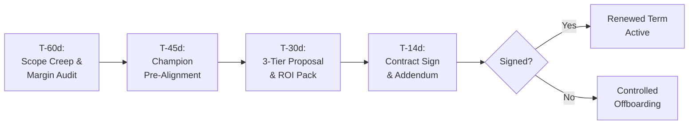

# renewal — Retainer Renewal: 60-Day Proactive Timeline, ROI Ledger, Scope Creep Retro, and 3-Tier Expansion

Crew Operations & Client Delivery engine for retaining high-value agency clients, preventing contract lapse, and expanding monthly recurring revenue (MRR).

---

## The Four Retainer Renewal Invariants

Every retainer renewal process must satisfy four operational invariants:

### RNW-001: 60-Day Proactive Timeline Gate
Never wait until the final 30 days of an engagement to discuss renewal. The agency initiates the proactive renewal cadence according to this strict calendar:
- **T-60 Days (Internal Audit)**: Run the Scope Creep Retro, analyze effective hourly rate (EHR), calculate delivered client ROI, and verify target renewal margins (>= 55% gross margin).
- **T-45 Days (Champion Pre-Alignment)**: Conduct an informal strategy session with the internal client champion to align on upcoming executive priorities for the next 6–12 months.
- **T-30 Days (Formal Renewal Pack Delivery)**: Present the Three-Tier Expansion Proposal with verified ROI receipts and roadmap commitments.
- **T-14 Days (Contract Execution Deadline)**: Finalize agreement and signature. If unexecuted at T-14, trigger the Retainer Offboarding Contingency plan to prevent unbillable post-contract work.

### RNW-002: Cumulative Economic Impact & ROI Ledger
A renewal proposal is never an invoice; it is an investment memorandum. Every renewal presentation must prove a minimum **3.0x Return on Investment (ROI)** across four quantitative categories:
1. **Direct Revenue Uplift**: Conversions, sales, or lead volume enabled by shipped features and optimizations.
2. **Infrastructure Cost Reduction**: Database query tuning, edge caching, server consolidation, and third-party SaaS tool replacements.
3. **Engineering Time Saved**: Developer hours saved through automations, continuous integration pipelines, and design systems.
4. **Downtime & Incident Prevention**: Zero-downtime database migrations, rate-limiting shields, and SLA uptime guarantees.

### RNW-003: Three-Tier Expansion Proposal Architecture
Always present three distinct options to prevent binary "stay vs leave" decisions:
- **Tier 1: Baseline Retainer (Steady-State)**: Maintains existing scope, P1–P4 SLA coverage, security patching, and core bug warranties. Indexed to inflation with a 5–8% annual rate adjustment.
- **Tier 2: Velocity & Optimization (+25% MRR — Recommended)**: Expands sprint capacity by 25%, adds bi-weekly conversion experiments (CRO), and includes quarterly architectural refactoring.
- **Tier 3: Dedicated Embedded Pod (+60%–100% MRR)**: Full-stack dedicated capacity with priority on-call support, subagent workflow automations, and executive quarterly strategy workshops.

### RNW-004: Scope Creep Retro & Margin Calibration
Before proposing renewal pricing:
- **Audit Out-of-Scope Requests**: Quantify how many hours or requests exceeded the original Statement of Work (SOW) during the prior contract term.
- **Calibrate Hourly Floor**: If unbilled scope creep dragged Effective Hourly Rate (EHR) below the target floor ($150/hr), adjust the baseline sprint capacity and contract minimum to protect healthy agency profitability.
- **Formalize Boundaries**: Explicitly re-fence the in-scope vs out-of-scope boundaries in the renewal agreement addendum.

---

## Renewal Milestone Timeline



---

## CLI & Tooling

Run the retainer renewal engine:
```bash
# Scaffold renewal pack with ROI ledger and 3-tier proposal
bun skills/agency-delivery/retain/scripts/renewal-engine.ts --scaffold-renewal --client "Acme Corp" --current-mrr 6000 --out renewal-pack.md

# Audit contract health, EHR, and scope creep margin impact
bun skills/agency-delivery/retain/scripts/renewal-engine.ts --audit-contract --contract-mrr 6000 --delivered-hours 120 --out-of-scope-hours 25

# Generate ROI receipts ledger
bun skills/agency-delivery/retain/scripts/renewal-engine.ts --roi-ledger --cost 72000 --value-generated 285000
```
