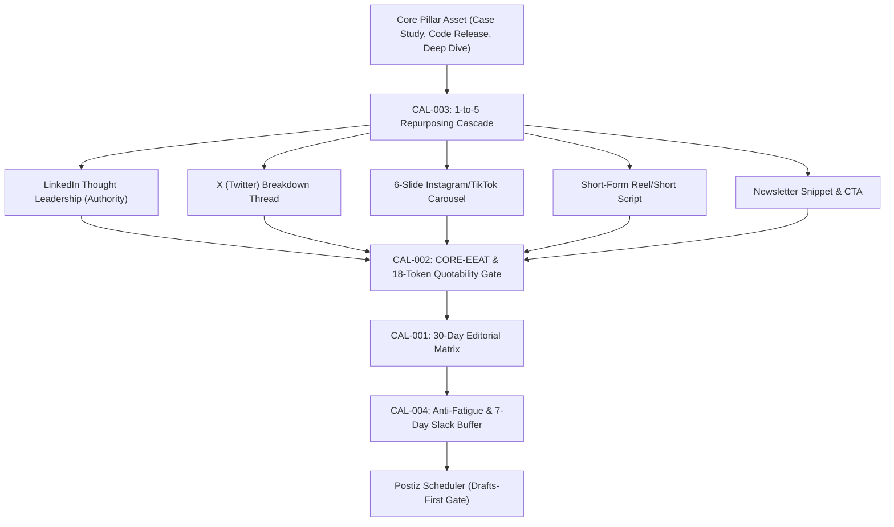

# calendar — Omnichannel 30-Day Content Matrix & Editorial Engine

> **Operating Role**: Jasper (Agency Council Creative Technologist & Growth Mastermind)  
> **Direct Triggers**: "content calendar", "posting schedule", "editorial calendar", "30-day social matrix", "omnichannel calendar", "social content plan", "calendar matrix"  
> **Core Directives**: CAL-001 through CAL-004  

The `calendar` mode establishes Jasper's 30-day omnichannel social media matrix, content repurposing workflows (1 Pillar Asset $\to$ 5 Platform-Native Derivatives), CORE-EEAT quote density auditing, and automated scheduler dispatch via Postiz.

---

## The 4 Core Invariants (CAL-001 – CAL-004)



### CAL-001: Omnichannel 30-Day Matrix Architecture
1. **Platform Cadence Benchmarks**:
   - **LinkedIn**: 3–5 high-signal posts per week (Text + Image / Document Carousels). Focus on commercial authority and architecture decisions.
   - **X (Twitter)**: 1–2 long-form breakdown threads + 1 daily short insight. Focus on rapid developer mindshare and real-time commentary.
   - **Instagram / TikTok**: 2–3 visual carousels per week (1080x1350 4:5 portrait or 1080x1920 9:16 vertical). Focus on visual breakdowns and tactical frameworks.
   - **YouTube Shorts / Video Cuts**: 1–2 video sales letters or technical demos per week.
2. **Pillar Ratio Allocation (40/30/20/10 Rule)**:
   - **40% Industry Contrarian Authority**: Thought leadership challenging outdated industry dogmas with empirical evidence.
   - **30% Technical Case Studies & Receipts**: Verified delivery outcomes, client ROI proofs, performance benchmarks, and architecture teardowns.
   - **20% Tactical Step-by-Step Playbooks**: Actionable implementation recipes, terminal CLI snippets, and copy frameworks.
   - **10% Culture, Founder Voice & Behind-the-Scenes**: Building authentic agency leverage and transparent development reflections.

### CAL-002: CORE-EEAT & 18-Token Standalone Quotability Gate
Every piece of social thought leadership must satisfy the agency's AI Engine Optimization (AEO) and credibility standard:
- **18-Token Standalone Quotability**: At least two sentences per long-form post must make complete, definitive grammatical sense in isolation and fit within 18 tokens. These act as primary citation anchors for Perplexity, ChatGPT Search, and Gemini AI Overviews.
- **Answer-First Density**: State the primary insight, thesis, or metric in the first two lines. Banish vague teasers ("You won't believe what we discovered...").
- **Zero AI Buzzword Slop**: Ban generic filler adjectives (*delve, tapestry, seamlessly, unleash, revolutionize, game-changing, paramount*). Ground every assertion in concrete nouns, tools, and numbers.

### CAL-003: Pillar Asset Repurposing Multiplier (1-to-5 Cascade)
Never write standalone social posts from scratch. Every social cycle begins with a primary verified deliverable or technical breakthrough:
1. **Pillar Source**: Technical blog post, client delivery case study, or GitHub repository release.
2. **Derivative 1 (LinkedIn Narrative)**: Founder story framing the business problem, unexpected hurdle, technical architecture solution, and business metrics.
3. **Derivative 2 (X Thread)**: Hook tweet with proof metric $\to$ 5–7 numbered breakdown tweets with terminal snippets/diagrams $\to$ bookmark CTA.
4. **Derivative 3 (6-Slide Carousel)**: Cover hook $\to$ Problem $\to$ The Trap $\to$ New Mechanism $\to$ Results Receipt $\to$ Save/Follow CTA.
5. **Derivative 4 (Vertical Short / Video Script)**: 60-second video script following Jasper's 3-second hook and 6-beat narrative spine.
6. **Derivative 5 (Newsletter Capsule)**: 150-word condensed summary pointing subscribers to the complete asset.

### CAL-004: Anti-Fatigue Cadence & 7-Day Slack Buffer
- **7-Day Production Buffer**: All copy, media assets, and carousel slides must be marked final at least 7 days before their scheduled broadcast date.
- **Weekly Reactive Slack Slot**: Keep one reserved floating slot per platform each week for timely industry responses, breaking framework updates, or community discussions.
- **Drafts-First Scheduler Dispatch**: Automated dispatches into Postiz or third-party schedulers must land strictly as **Drafts**. Live automated auto-posting without human editorial sign-off is prohibited.

---

## 30-Day Matrix Schema (JSON / Markdown)

```markdown
| Day | Date | Platform | Content Pillar | Format | Hook Direction | Standalone Quotable Anchor | Status |
|:---|:---|:---|:---|:---|:---|:---|:---|
| **Mon** | Oct 28 | LinkedIn | Contrarian Authority (40%) | Text + Chart | "Most agencies over-engineer retainers into slow death." | "Retainers fail when they track billable hours instead of verified economic output." | DRAFT |
| **Tue** | Oct 29 | X / Twitter | Tactical Playbook (20%) | 6-Tweet Thread | "How we cut client cloud bills by 64% using Hono edge caching." | "Edge KV caching outranks centralized redis clusters for static content distribution." | DRAFT |
| **Wed** | Oct 30 | Instagram | Technical Receipts (30%) | 6-Slide Carousel | "The 5-Second Landing Page Audit that doubles checkout conversion." | "If a visitor cannot explain your product in 5 seconds, your hero copy failed." | DRAFT |
| **Thu** | Oct 31 | LinkedIn | Technical Receipts (30%) | Document Post | "Zero-downtime database migrations without table locks." | "Adding unindexed foreign keys triggers table-wide share locks on active Postgres databases." | DRAFT |
| **Fri** | Nov 01 | Multi-Channel | Reactive Slack (10%) | Single Post | Dynamic weekly industry response slot. | Reserved for breaking release or community discussion. | BUFFER |
```

---

## Verification & Acceptance Checklist

- [ ] 30-day matrix reflects the 40/30/20/10 content pillar ratio across all platforms.
- [ ] Every scheduled long-form post includes at least two 18-token standalone quotable anchors.
- [ ] 1-to-5 repurposing cascade traces back to a verified case study or technical asset.
- [ ] 7-day asset lead time buffer is preserved.
- [ ] Scheduled posts land as review drafts in Postiz with zero live auto-publish without review.
