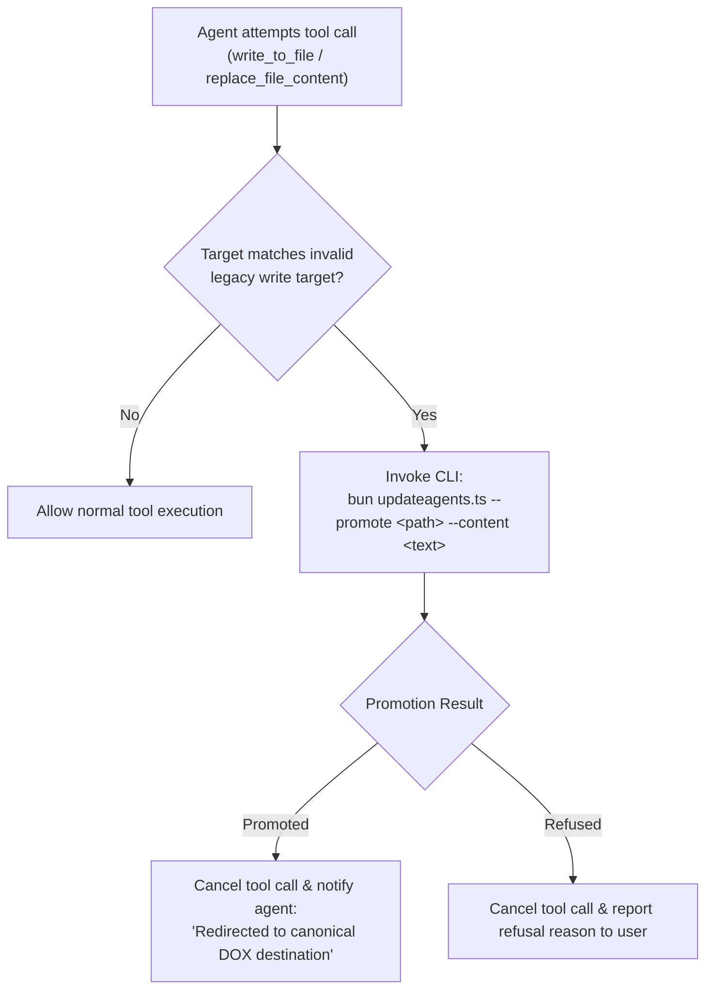

# 🛡️ Legacy-Write Promotion Policy & Interception Specification

> **Core Invariant**: No parallel instruction file is ever created or updated. When an agent or tool attempts to write or update a foreign-harness instruction file, the intent is intercepted, classified, promoted to the best-fit Agent Engine DOX location, and the workspace router (`AGENTS.md`) is resynced.

---

## 1. Scope & Invalid Write Targets

The DOX Progressive Disclosure architecture establishes `AGENTS.md` and `.agents/` as the single authoritative instruction canon. Foreign-harness instruction files are legacy adapters, never authoring targets.

### 🚫 Invalid Write Targets (Never Write; Promote Instead)

The following directory patterns and file names are strictly forbidden as write targets:

| Target Category | Prohibited Paths & Patterns | Status |
| :--- | :--- | :--- |
| **Legacy Harness Directories** | `.claude/`, `.gemini/`, `.cursor/`, `.windsurf/`, `.aider/`, `.continue/`, `.codex/`, `.copilot/`, `.github/instructions/`, `.clinerules/`, `.roo/`, `.opencode/` | Prohibited write target; intercept & promote |
| **Legacy Instruction Files** | `CLAUDE.md`, `CLAUDE.local.md`, `GEMINI.md`, `CODEX.md`, `.cursorrules`, `.windsurfrules`, `.aider.conf.yml`, `.github/copilot-instructions.md`, `copilot-instructions.md`, `.clinerules`, `OPENCODE.md`, `OPENCODE_INSTRUCTIONS.md`, `*.instructions.md` | Prohibited write target; intercept & promote |
| **Compiled IDE Artifacts** | `.cursor/rules/*.mdc`, `.github/copilot-instructions.md` | **Never hand-edited or promoted**. Auto-generated via `updateagents --sync-ide` from `.agents/standards/`. Refuse and redirect. |

*(Reconciled with [references/memory-file-priorities.md](memory-file-priorities.md). No competing priority list exists.)*

### ✅ Allowed & Untouched Targets

The following paths are authoritative canonical structures or deliberate exceptions and are never intercepted or altered:

1. `AGENTS.md` (anywhere in the repository tree)
2. `.agents/**` (the entire Progressive Disclosure DOX tree)
3. `skills/*/CLAUDE.md` and `templates/CLAUDE.md` (skill-internal instruction templates; documented runtime exception)

---

## 2. Deterministic Routing Ladder

When a write to a prohibited target is intercepted, resolve the destination in strict priority order:

```text
Target Path Walk
       ↓
Is Compiled IDE Artifact? (.mdc / copilot-instructions.md) ──→ REFUSE: Point at --sync-ide
       ↓
Is Shell/Bash Mutation or Content > 8KB? ────────────────────→ REFUSE: Manual placement required
       ↓
Find Nearest Ancestor Agent Engine Container (.agents/ or AGENTS.md)
       ├── Container Found:
       │     ├── Rule-Like Content (imperatives + policy vocabulary) ──→ <container>/.agents/standards/<name>.md
       │     └── Project Knowledge / Facts ───────────────────────────→ <container>/.agents/context/<bucket>.md
       └── No Container Found:
             ├── Inside $HOME ────────────────────────────────────────→ ~/.agents/AGENTS.md (R2 Global Router)
             └── Outside $HOME ───────────────────────────────────────→ REFUSE & ESCALATE: Unknown scope; zero guessing
```

### Ladder Rules

1. **Nearest Ancestor Agent Engine Container**:
   Traverse upward from the target path directory until a folder containing `.agents/` or `AGENTS.md` is encountered.
   - **Rule-Like Guidance**: Routed to `<container>/.agents/standards/<name>.md`.
     - *Classification Gate*: Evaluates presence of **imperatives** (`never`, `always`, `must`, `do-not`, `don't`, `prefer`, `avoid`, `require`) AND **governance vocabulary** (`convention`, `standard`, `policy`, `rule`, `guideline`, `ADR`).
     - *Destination Selection*: Maps to existing modular standards (e.g. `security-vibeguard.md`, `git-workflow.md`, `execution-kernel.md`, `anti-patterns.md`, `workflows.md`) or creates a scoped standard `<name>.md`.
   - **Project Knowledge & Facts**: Routed to `<container>/.agents/context/<name>.md`.
     - *Bucket Selection*: Reuses existing context buckets from `templates/.agents/context/` instead of inventing arbitrary files:
       - `decisions.md` — Architectural choices, tradeoffs, and ADR records.
       - `architecture.md` — System structure, boundaries, services, and data flows.
       - `stack.md` — Tooling, packages, libraries, language runtimes, and dependencies.
       - `current.md` — Active sprint, shipped features, current state, and operational gotchas.
       - `product.md` — Product scope, user persona, problem statement, and requirements.
       - `accounts.md` — Environments, accounts, and infrastructure endpoints (no secrets).
       - `roadmap.md` — Upcoming milestones, future plans, and deferred tasks.
       - Fallback bucket: `imported-agent-instructions.md`.
2. **Home-Level Legacy Target (No Container)**:
   If the target resides under `$HOME` and has no ancestor Agent Engine container, route to `~/.agents/AGENTS.md` in adherence to the Zero-Claude Global Architecture (R2).
3. **Compiled IDE Artifacts Refusal**:
   Compiled artifacts (`.cursor/rules/*.mdc`, `.github/copilot-instructions.md`) must never be hand-edited or promoted. The engine refuses the write with code 1 and directs the user to run `bun path/to/updateagents.ts --sync-ide` to regenerate them from `.agents/standards/`.
4. **Unknown Scope Refusal & Escalation**:
   If the target is outside `$HOME` and lacks an ancestor container, the engine **refuses loudly and escalates to the user**. It MUST NOT guess or fall back to writing global `~/.agents/AGENTS.md`. Guessing here is a defect.
5. **Shell/Bash Mutations & Size Limits**:
   Content containing shell/bash execution scripts (`#!/bin/...`, pipe-to-shell, mutations) or exceeding **8KB** (8,192 bytes) is refused. The engine instructs the team to place the material manually.

---

## 3. Mandatory Safety Rails

Every promotion execution must satisfy the following safety rails:

### A. Whitespace-Normalized Deduplication
Before appending or writing, normalize whitespace (`\r\n` → `\n`, trim lines, eliminate redundant blank lines). If the normalized content is already present in the destination file, the engine skips the write, reports `Zero changes made (deduplicated)`, and exits 0. A repeat promotion must add nothing.

### B. Lossless Provenance Envelope
Every promoted block is wrapped in an explicit provenance comment block. Original text is preserved byte-for-byte:

```markdown
<!-- updateagents:promoted-legacy-write:start -->
### Promoted from `<sourcePath>` (<harness>) on <YYYY-MM-DD>
> Reason: <routing reason>

<original content>
<!-- updateagents:promoted-legacy-write:end -->
```

### C. Merge, Don't Duplicate (R2)
Never create a parallel instruction file. Merge into the canonical destination file, appending to existing sections cleanly.

### D. File Size Guidelines
- **Ideal Target**: 2–5KB per context/standards file.
- **Warning Threshold**: Emit an audit warning if the destination file reaches $\ge$ 10KB.

### E. Pre-Write Archiving
If a legacy instruction file already exists on disk and is being adapted or replaced, snapshot its exact bytes to `.agents/archive/agent-instructions/<hash>-<name>` and register it in `manifest.json` before touching the file. Never destroy human-authored instructions.

### F. Router Resync Gate
After writing promoted content, the workspace router (`AGENTS.md`) is immediately resynced. If a standard was created or updated, verify it is linked; if context was modified, update `imported-agent-instructions-router` or context hashes so future agents discover the knowledge immediately.

---

## 4. Optional Harness Interception Contract

> **Independence Guarantee**: The skill is completely harness-independent. It does not rely on any specific runtime, daemon, or plugin API. The contract below specifies how external runtimes can optionally intercept write intents before they reach the filesystem.

Harnesses supporting pre-tool execution hooks or file write guards (e.g. Claude Code hooks, opencode hooks, Cursor rules, Gemini CLI sidecars) can implement the following zero-leak interception flow:



### Protocol Specifications
1. **Tool Invocation Interception**: Hook inspects the target file path before executing file modifications.
2. **Match Evaluation**: Compare path against the Invalid Write Targets table.
3. **Execution**: Pass the candidate path and proposed content to `bun path/to/updateagents.ts --promote <path>`.
4. **Agent Feedback**: Return the promotion report to the model transcript so the agent knows the canonical destination (`.agents/standards/` or `.agents/context/`).
