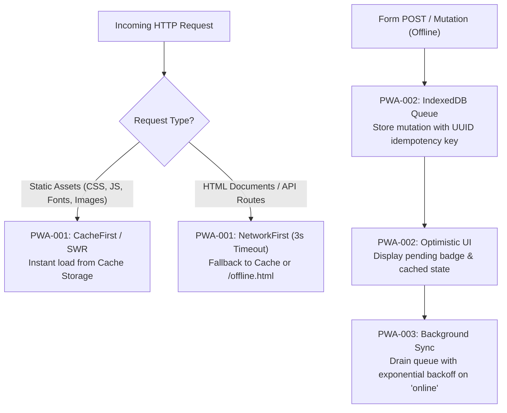

# offline — Progressive Web App & Offline-First Architecture

> **Operating Role**: Sol (Agency Council Product Architect & Full-Stack Automator)  
> **Direct Triggers**: "offline mode", "pwa", "service worker", "offline caching", "background sync", "offline form queue", "progressive web app", "sw generator"  
> **Core Directives**: PWA-001 through PWA-004  

The `offline` mode establishes resilient Progressive Web App (PWA) architecture, service worker lifecycle orchestration, multi-tier runtime caching strategies, and robust client-side mutation queues for seamless offline-first web experiences.

---

## The 4 Core Invariants (PWA-001 – PWA-004)



### PWA-001: Two-Tier Caching Architecture
1. **CacheFirst for Static Assets**:
   - Content-hashed CSS bundles, JS modules, static WebP/SVG images, and WOFF2 fonts must be cached aggressively via Cache Storage (`v1-static-assets`).
   - If present in cache, respond immediately without network lookup.
   - If absent, fetch from network, populate cache asynchronously, and return response.
2. **NetworkFirst with 3s Timeout for Dynamic Content**:
   - Navigation requests (`Request.mode === 'navigate'`) and REST/GraphQL API queries must attempt the network first with an enforceable 3000ms timeout race.
   - If network completes in $\le 3000\text{ms}$, update the runtime cache (`v1-runtime-cache`) and return fresh data.
   - If network times out, throws, or device is offline:
     - For navigations: return cached HTML route or fallback to pre-cached `/offline.html`.
     - For API reads: return cached JSON response with `X-Data-Source: offline-cache` response header.

### PWA-002: Offline Mutation Queue & Optimistic UI
- **Zero Data Loss on Form Submissions**: When `navigator.onLine === false` or network requests reject with `TypeError: Failed to fetch`:
  1. Intercept mutation (POST, PUT, PATCH, DELETE).
  2. Generate a cryptographically secure idempotency key (`crypto.randomUUID()`).
  3. Persist mutation payload, target URL, HTTP method, headers, and timestamp into IndexedDB (`offline_db` / `mutations` object store).
  4. Emit custom event `mutation-queued` to update local client state optimistically.
- **Optimistic State Badging**: Mutated entities must be rendered in UI immediately with an `is-pending-sync` visual badge, preventing duplicate user submissions.

### PWA-003: Background Sync & Auto-Reconnection Lifecycle
- **SyncManager Registration**:
  ```typescript
  if ('serviceWorker' in navigator && 'SyncManager' in window) {
    const reg = await navigator.serviceWorker.ready;
    await reg.sync.register('sync-mutations');
  }
  ```
- **FIFO Queue Draining**: When network reconnects (via Service Worker `sync` event or window `online` listener):
  - Read mutations in chronological FIFO sequence from IndexedDB.
  - Dispatch requests with `Idempotency-Key: <key>` header.
  - On HTTP 2xx: remove item from IndexedDB and emit `mutation-synced`.
  - On HTTP 4xx/5xx: apply exponential backoff with full jitter ($\text{delay} = \text{random}(0, \min(30000, 1000 \times 2^{\text{retry}}))$).
  - Stop queue processing on critical 401/403 auth errors and trigger re-authentication alert.

### PWA-004: Manifest & Installation Compliance
- **Standard Manifest Configuration (`manifest.webmanifest`)**:
  - `display: "standalone"`
  - `start_url: "/"`
  - `orientation: "any"`
  - Theme colors coordinated with brand OKLCH tokens (`theme_color`, `background_color`).
  - Icons array containing standard PNGs:
    - 192x192 (`purpose: "any"`)
    - 512x512 (`purpose: "any"`)
    - 512x512 (`purpose: "maskable"`)
- **HTTPS Enforcement**: PWAs must be delivered exclusively over TLS 1.3 / HTTPS (except `localhost` for local development).

---

## Canonical Service Worker Template (`sw.js`)

```javascript
const CACHE_VERSION = 'v1.0.0';
const STATIC_CACHE = `static-${CACHE_VERSION}`;
const RUNTIME_CACHE = `runtime-${CACHE_VERSION}`;
const OFFLINE_URL = '/offline.html';

const PRECACHE_ASSETS = [
  '/',
  '/offline.html',
  '/favicon.ico',
  '/manifest.webmanifest'
];

self.addEventListener('install', (event) => {
  event.waitUntil(
    caches.open(STATIC_CACHE).then((cache) => cache.addAll(PRECACHE_ASSETS))
  );
  self.skipWaiting();
});

self.addEventListener('activate', (event) => {
  event.waitUntil(
    caches.keys().then((keys) =>
      Promise.all(
        keys.filter((key) => key !== STATIC_CACHE && key !== RUNTIME_CACHE).map((key) => caches.delete(key))
      )
    )
  );
  self.clients.claim();
});

self.addEventListener('fetch', (event) => {
  const { request } = event;
  const url = new URL(request.url);

  if (request.method !== 'GET') return;

  // 1. Static Assets: CacheFirst
  if (url.origin === self.location.origin && /\.(css|js|woff2|png|svg|webp|ico)$/.test(url.pathname)) {
    event.respondWith(
      caches.match(request).then((cached) => cached || fetch(request).then((res) => {
        const copy = res.clone();
        caches.open(STATIC_CACHE).then((cache) => cache.put(request, copy));
        return res;
      }))
    );
    return;
  }

  // 2. Navigation / HTML: NetworkFirst with 3s Timeout
  if (request.mode === 'navigate') {
    event.respondWith(
      Promise.race([
        fetch(request).then((res) => {
          const copy = res.clone();
          caches.open(RUNTIME_CACHE).then((cache) => cache.put(request, copy));
          return res;
        }),
        new Promise((_, reject) => setTimeout(() => reject(new Error('Network timeout')), 3000))
      ]).catch(() => caches.match(request).then((cached) => cached || caches.match(OFFLINE_URL)))
    );
  }
});
```

---

## Verification & Acceptance Checklist

- [ ] `sw.js` registers cleanly in browser with zero lifecycle console errors.
- [ ] Static assets load from `CacheStorage` upon refreshing in disconnected airplane mode.
- [ ] Disconnecting Wi-Fi navigates gracefully to `/offline.html` rather than browser crash dinosaur.
- [ ] Offline form mutations serialize cleanly to IndexedDB and replay with idempotency keys upon reconnect.
- [ ] Lighthouse PWA audit scores $\ge 90$ with valid `manifest.webmanifest`.
