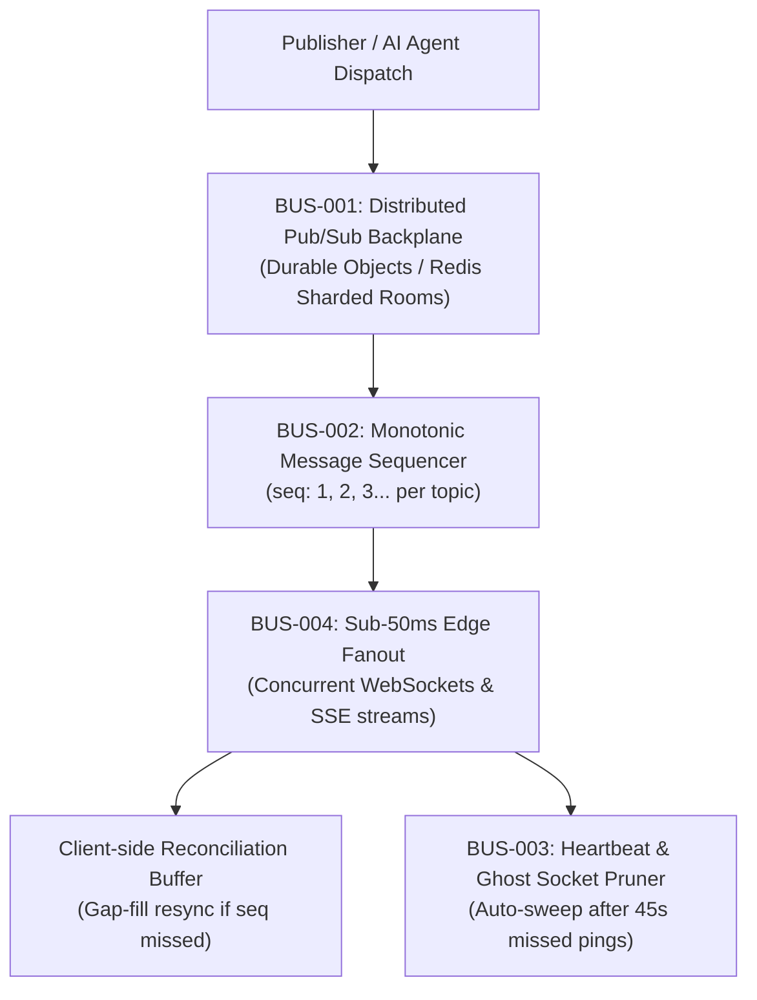

# realtime-bus — Distributed WebSockets & Server-Sent Events Engine

> **Council Lead**: **Sol** (Product Architect & Full-Stack Automator)  
> **Tooling**: `bun webdev/scripts/realtime-bus.ts`  
> **Mode Command**: `/webdev realtime-bus`  
> **Standards**: Cloudflare Durable Objects / Redis Pub/Sub, Monotonic Sequence IDs, 45s Heartbeat Pruning, Sub-50ms Fanout SLA

---

## ⚡ Purpose & Problem Statement

Modern collaborative web apps, live agent streaming, real-time dashboards, and multiplayer canvases require bidirectional real-time communication. However, naive WebSocket implementations suffer from silent connection dropouts, out-of-order message delivery over lossy mobile networks, memory leaks from zombie/ghost connections, and severe broadcast latency bottlenecks under load.

The `webdev:realtime-bus` engine provides a distributed pub/sub backplane across Cloudflare Durable Objects and Redis, enforces monotonic message sequence numbers with client-side gap reconciliation, sweeps dead sockets after 45s of missed pings, and benchmarks sub-50ms edge fanout delivery.

---

## 🏛️ Core Invariants



### 1. `BUS-001` — Distributed Pub/Sub Backplane
- Shards connections into named topic rooms (e.g., `chat:room_1`, `orders:live`, `canvas:workspace_a`).
- Routes across edge nodes using Cloudflare Durable Objects or multi-region Redis Pub/Sub.

### 2. `BUS-002` — Guaranteed Monotonic Message Ordering
- Assigns strictly increasing positive integer sequence IDs (`seq: 1, 2, 3...`) to every message published within a room.
- Provides client-side reconciliation buffer logic that detects gaps (e.g. received `[1, 2, 4]` triggers gap-fill request for sequence `3`).

### 3. `BUS-003` — Heartbeat & Ghost Connection Pruning
- Enforces bidirectional ping/pong heartbeats every 15–30 seconds.
- Automatically marks sockets as `PRUNED` and deregisters room subscriptions when no ping is received for $> 45\text{s}$ (45,000ms), eliminating zombie memory leaks.

### 4. `BUS-004` — Sub-50ms Edge Fanout SLA
- Edge fanout latency (time from `publish()` call to delivering to all active subscriber memory buffers) must benchmark at $p95 < 50\text{ms}$ for up to 10,000 concurrent listeners.

---

## 💻 CLI Usage

```bash
# Run standard fanout benchmark (500 subscribers, 10 rooms)
bun webdev/scripts/realtime-bus.ts

# Scale simulation to 2,000 concurrent subscribers across 20 rooms
bun webdev/scripts/realtime-bus.ts --simulate-subscribers 2000 --rooms 20

# Output structured JSON report for observability pipelines
bun webdev/scripts/realtime-bus.ts --simulate-subscribers 1000 --json
```

---

## 📋 Quality & Verification Gate

- [ ] Messages assigned strictly monotonic integer sequence IDs within each room.
- [ ] Client gap detection catches dropped sequence numbers and requests gap-fills.
- [ ] Sockets with missed pings $> 45\text{s}$ pruned cleanly with zero memory leaks.
- [ ] Fanout latency satisfies $p95 < 50\text{ms}$ SLA across concurrent subscriber pools.
